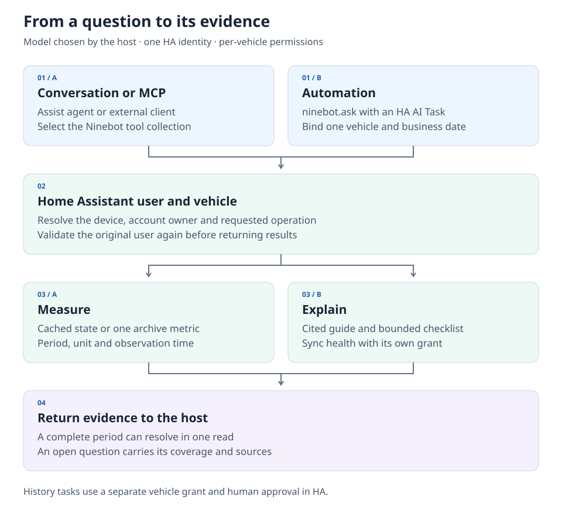
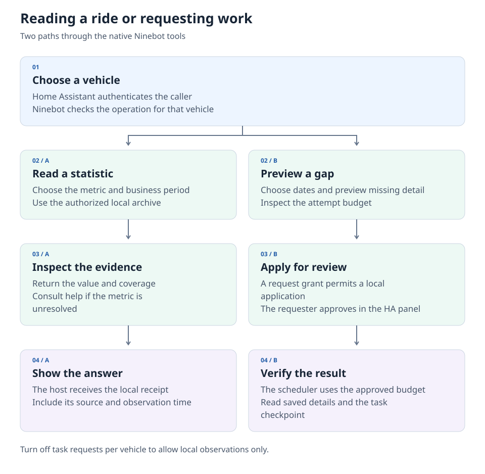
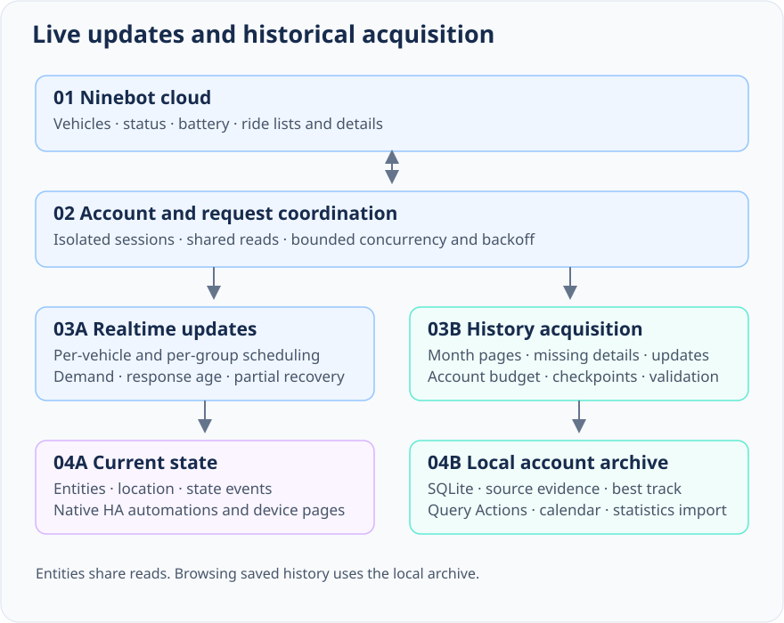

# Ninebot for Home Assistant

**Vehicle telemetry, a private ride archive and an optional Home Assistant tool collection.**

English · [简体中文](README_zh.md)

<!-- ha-marketplace:exclude-start -->
   
<!-- ha-marketplace:exclude-end -->

[Install](#installation) · [Ride history](#ride-history-and-track-synchronization) · [Assistant](#ninebot-assistant) · [Guides](docs/README.md)

Check your vehicle, keep its rides and use both in Home Assistant. Each Ninebot account has its own vehicles, permissions and local SQLite archive.

**Stable** · [v2.2.0](https://github.com/Wuty-zju/ha_ninebot/releases/latest) for everyday use. **Preview** · [v2.2.13](CHANGELOG.md#2213) supports daily follow-ups across vehicles and shares the map’s selection, replay and statistics. If your host still selects **Ninebot tasks**, follow the [single-API upgrade](docs/assistant.md#upgrade-to-the-single-ninebot-api).

## What you can do

| Where to start | What you get |
|---|---|
| **Device overview** | Battery charge, range, temperature, location and confirmed lock state, according to what the vehicle reports. Use the same entities in dashboards and automations. |
| **Ride history** | Daily and monthly statistics, an optional ride calendar and a local archive that can outlive the cloud’s detailed track. |
| **History map** · preview | Pick up to five saved rides across vehicles and dates. See where their routes diverge, replay one and compare their recorded distance, time and energy. |
| **Assistant** · opt-in | Ask a tool-capable host about one vehicle. Answers can draw on a timestamped observation, a saved trip, period statistics or a cited passage from the guide. |

## Installation

### Requirements

Home Assistant **2026.1.0 or newer**, a supported 64-bit runtime, and an account with vehicles visible in the Ninebot app. Authentication and live data require internet access. Saved rides can be read locally. The optional native Assistant tools require a compatible HA API and host. [Platform and account requirements](docs/guide.md#requirements)

Service-region and platform coverage are listed in the user guide.

<!-- ha-marketplace:exclude-start -->

### Marketplace · Home Assistant 2026.11 and newer

Install from the repository link today. In **Settings → Marketplace → ⋮ → Add from link**, connect GitHub if prompted and enter `Wuty-zju/ha_ninebot` as an **Integration**. Install the stable version and open Ninebot's account setup. Projects in the default catalog can be found through Marketplace search after you accept the Marketplace warning. [Marketplace installation guide](docs/guide.md#install-through-marketplace--ha-202611)

### HACS on older Home Assistant versions

1. Open **HACS → ⋮ → Custom repositories** and add `https://github.com/Wuty-zju/ha_ninebot` as an **Integration**.
2. Open **Ninebot**, download the stable release and restart when prompted.
3. Open **Settings → Devices & services → Add integration → Ninebot**.

### Manual installation

Download `ninebot.zip` from [the latest stable release](https://github.com/Wuty-zju/ha_ninebot/releases/latest). Extract it into `<config>/custom_components/ninebot/` with `manifest.json` directly in that directory. Restart Home Assistant and add Ninebot from **Devices & services**. The release includes `SHA256SUMS`.

<!-- ha-marketplace:exclude-end -->

### Upgrading from 1.x

Back up the Home Assistant configuration and private storage first. The 2.0 refactor introduced a new account model and moved some functions to native Lock entities. Check existing automations against the migration guide. Installations already on 2.x can update in place. [Migration and rollback](docs/migration.md)

## Add your accounts

Open **Settings → Devices & services → Add integration → Ninebot** and sign in. Each account gets its own entry. On a new account, **Balanced** controls polling. Vehicle location and eligible controls have separate settings. In **Configure**, choose which vehicles can receive commands.

For a route library, turn on **automatic history scanning** and **automatic detail synchronization**. The ride calendar and Assistant have their own switches. Leave battery ratings blank until you know the nominal voltage and capacity. [Defaults and options](docs/guide.md#options)

## Ride history and track synchronization

Use the device page for today, yesterday, this month and the latest ride. Open the ride history card to investigate an individual journey. Choose a vehicle and date range, select a ride and add others with **+**. Numbered routes share one Home Assistant map. At an overlap, pick the matching vehicle and departure time.

| On the map in 2.2.12 | How to read it |
|---|---|
| Playback | The cursor visits saved points in order. Drag to inspect a point. The ride’s distance, duration and energy describe the entire trip. |
| Current ride and selection | Compare the active ride with up to five selected rides. Average speed uses total distance divided by summed ride time. Energy use per kilometre uses total Wh divided by total km. Missing inputs show how many rides contribute. |
| One ride in focus | Keep the current ride to clear the others while preserving its playback position. An endpoint-only record shows the two known positions. |

The library reads the account archive. The same data is available to automations through `ninebot.get_recorded_trips` and `ninebot.get_trip_detail`. [Set up the map and read coverage](docs/history.md)

## Ninebot Assistant

Select the data a vehicle may share, then enable **Ninebot** in your Assist host or Home Assistant MCP Server. An external client can use `/api/mcp/ninebot`. For an automation, `ninebot.ask` takes a vehicle and an existing `ai_task` entity. Your host chooses the model.

<picture>
  <source media="(prefers-color-scheme: dark)" srcset="docs/assets/architecture/assistant-en-dark.svg">
  
</picture>

| Question or request | Evidence or decision |
|---|---|
| “How many rides did I take yesterday?” | The selected vehicle’s business date, count, coverage and observation time. Two vehicles with the same name can be distinguished by their HA device reference. |
| “Why is that count missing?” | In 2.2.12 the check reads just the requested metric. A verified closed period takes one local read. An unresolved value can use cited help and, when allowed for this vehicle, sync health. |
| “Save the missing details for these dates.” | The host may preview local gaps or file a bounded application. The requester reviews the range and request budget in Home Assistant before the scheduler starts. |

Precise routes stay in the map and archive. Review the selected scalar values, dates and labels before exposing them to an external model. [Set up Assistant and its permissions](docs/assistant.md)

Follow a local read and a reviewed sync request

<picture>
  <source media="(prefers-color-scheme: dark)" srcset="docs/assets/architecture/assistant-tasks-en-dark.svg">
  
</picture>

## How it works

Each account has a coordinator for current observations and a scheduler for historical acquisition. Entities share the most recent successful reading in their group. Browsing an archived ride or moving the replay cursor uses local data.

<picture>
  <source media="(prefers-color-scheme: dark)" srcset="docs/assets/architecture/overview-en-dark.svg">
  
</picture>

On **Balanced**, parked status and battery target 60 seconds. During charging those targets become 15 and 30 seconds, and with active accessory power they become 10 and 30 seconds. Control readback has its own short observation window. [Polling profiles](docs/guide.md#update-speed) · [Architecture](docs/architecture.md)

## Your local ride database

SQLite stores each account’s rides, month membership, source evidence and best available track. A verified page and its checkpoint commit together. When a scan resumes it reuses that work. A later server response containing only endpoints can update scalar information while the fuller saved route remains available.

<picture>
  <source media="(prefers-color-scheme: dark)" srcset="docs/assets/architecture/archive-en-dark.svg">
  
</picture>

The default storage allowance is **100 MiB per account**. Background acquisition shares **60 logical requests per account per hour** by default. Removing an account retains its archive by default. Export one or more vehicles for transfer, or reconnect the same account to resume from its saved records. Keep exports and HA backups private if they include locations. [Backup and restore](docs/guide.md#export-and-import-history-databases) · [Storage contracts](docs/architecture.md#storage-and-integrity)

## Documentation and contribution

| Reader | Start here |
|---|---|
| Installing or upgrading | [Everyday guide](docs/guide.md) · [Migration and entity identity](docs/migration.md) |
| Building a dashboard or automation | [Ride history and maps](docs/history.md) · [Assistant reference](docs/assistant.md) |
| Developing or reviewing | [Code and test map](docs/development.md) · [Architecture](docs/architecture.md) · [Contributor workflow](CONTRIBUTING.md) · [Agent handbook](AGENTS.md) |
| Following the project | [Roadmap](docs/roadmap.md) · [Changelog](CHANGELOG.md) · [All documentation](docs/README.md) |

**Downloads** counts downloads of the published `ninebot.zip` assets, including updates and repeat downloads. [How the count is calculated](docs/development.md#package-download-audit)

## License and acknowledgements

Independently maintained under the MIT license. Ninebot and Segway names and imagery belong to their owners. [License](LICENSE) · [Acknowledgements](NOTICE) · [Security reports](SECURITY.md)
