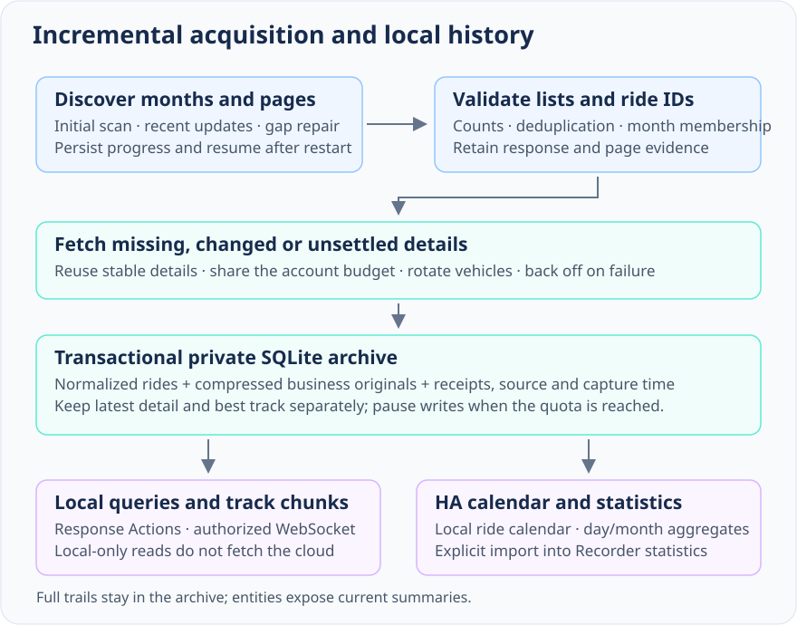
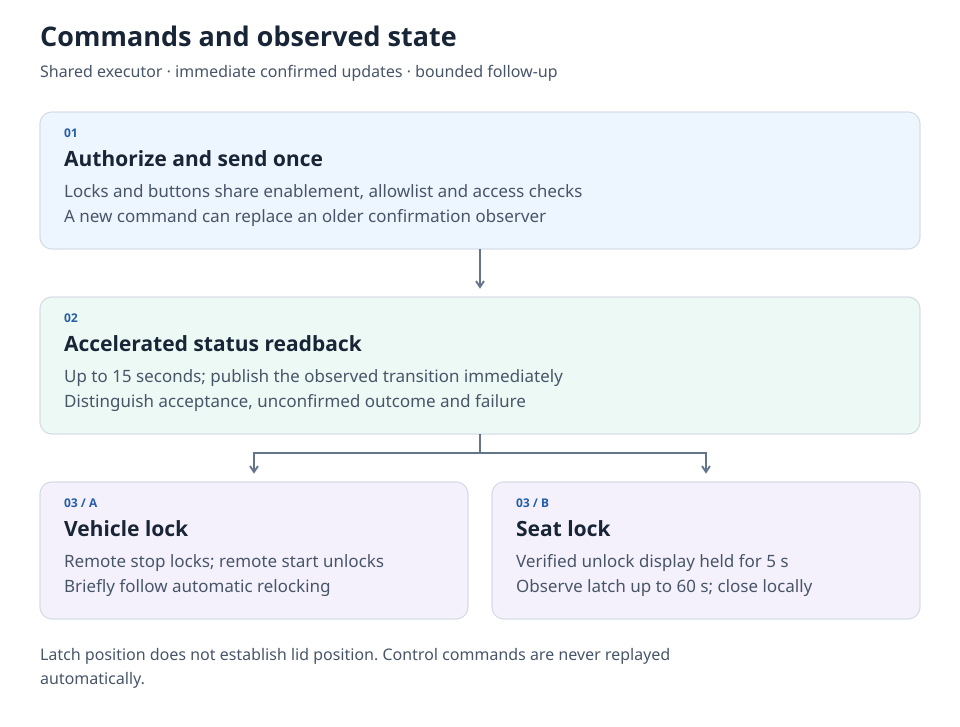

# Ninebot for Home Assistant

**Vehicle telemetry, ride history and local queries for your Ninebot vehicles.**

English · [简体中文](README_zh.md)

    

[Installation](#installation) · [Ride history](#ride-history-and-track-synchronization) · [Ninebot Assistant](#ninebot-assistant) · [Architecture](#how-it-works) · [Documentation](docs/README.md)

Connect an account to see battery charge, range, location and vehicle state in Home Assistant. Save rides and detailed routes to a private local archive, then use calendars, statistics or automations to explore them. Ninebot Assistant can query the same records through your chosen AI host.

**[Stable release · v2.2.0](https://github.com/Wuty-zju/ha_ninebot/releases/tag/v2.2.0)** brings the improvements from the 2.0 maintenance and 2.1 preview series into one release. Existing accounts keep their settings, entity identities and ride archives. [Changes since 2.0.0](CHANGELOG.md#220) · [Upgrade guide](docs/migration.md)

## What you can do

| In Home Assistant | Information and actions |
|---|---|
| **Vehicle device page** | Main and communication battery charge, measured voltage, temperature, supported cycle data and charging power. Precise, estimated and AI range follow separate source fields. |
| **Map and controls** | Show the vehicle's reported location. Lock or unlock a supported vehicle, release the seat latch or ring the bell. A fresh observation confirms a state change. |
| **Ride summaries** | View day and month totals and the latest ride. Compare the reported maximum speed with the average calculated from distance and elapsed time. |
| **Local history** | Browse saved rides, calendar entries and route details. Import daily or monthly aggregates into Home Assistant's long-term statistics. |
| **Automations and Assist** | React to trip or vehicle events, query structured Action responses, or ask a compatible Assistant host about a vehicle you have selected. |

Vehicles report different measurements. A missing reading stays unknown, and a reported zero keeps its own meaning. The [entity guide](docs/guide.md#entities-and-data) covers battery support, units and availability.

## Installation

### Requirements

Home Assistant **2026.1.0 or newer**, a supported 64-bit runtime, and an account with vehicles visible in the Ninebot app. Authentication and live data require internet access. Saved rides can be read locally. The optional native Assistant tools require a compatible HA API and host. [Platform and account requirements](docs/guide.md#requirements)

### Marketplace · Home Assistant 2026.11 and newer

1. Open **Settings → Marketplace → Custom repositories**. Connect GitHub if prompted.
2. Add `https://github.com/Wuty-zju/ha_ninebot` as an **Integration**.
3. Install **Ninebot**, follow any restart prompt, then choose **Add integration → Ninebot**.

Ninebot is distributed as a custom repository. [Marketplace installation guide](docs/guide.md#install-through-marketplace--ha-202611) · [Home Assistant Marketplace](https://www.home-assistant.io/blog/2026/11/04/release-202611/#welcome-to-the-marketplace)

### HACS

1. Open **HACS → ⋮ → Custom repositories** and add the same URL under **Integration**.
2. Open **Ninebot**, download the stable release and restart when prompted.
3. Open **Settings → Devices & services → Add integration → Ninebot**.

### Manual installation

Download `ninebot.zip` from [Releases](https://github.com/Wuty-zju/ha_ninebot/releases/latest). Extract its contents into `<config>/custom_components/ninebot/` so the manifest sits directly in that directory. Restart Home Assistant and add Ninebot from **Devices & services**. The release also includes `SHA256SUMS`. Home Assistant installs the declared runtime dependency.

### Upgrading from 1.x

Back up the Home Assistant configuration and private storage first. The 2.0 refactor introduced a new account model and moved some functions to native Lock entities. Check existing automations against the migration guide. Installations already on 2.x can update in place. [Migration and rollback](docs/migration.md)

## Add your accounts

Sign in with the account and password used in the Ninebot app. Each account gets its own integration entry, session and archive. Open **Configure** after sign-in to choose what runs for that account.

### Choose what runs

| Option on a new account | Default |
|---|---|
| Update speed | **Balanced**, with separate schedules for each vehicle and data group |
| Location, vehicle controls, vehicle/trip events (Beta) | **On**. Controls initially select vehicles verified during sign-in |
| Retain the local ride database on account removal (Beta) | **On** |
| Ride calendar, automatic history scan and detail synchronization (Beta) | **Off** |
| Ninebot Assistant and Assistant history tasks (Beta) | **Off**, with separate account consent and vehicle selection |
| Diagnostic entities | **Off** |

Explicit choices survive updates. Battery specifications can be left blank. [Polling profiles, options and limits](docs/guide.md#options)

## Ninebot Assistant

Enable Assistant for an account, select its vehicles and choose the **Ninebot** API in a compatible native Conversation or MCP host. You can ask “How far did I ride yesterday?” or “Why is detail synchronization waiting?” The eight read tools use local observations, archive statistics and versioned public help. Your host selects the model.

For automations, `ninebot.ask` can use an existing Home Assistant AI Task. Display its optional `answer.text` for a cited help excerpt or a measured result with coverage. Read `results` for the underlying tool responses. An external host controls its own wording.

A separate **Ninebot tasks** option lets a client prepare a request to fill missing details. An administrator reviews the selected scope and cloud-request allowance before the history scheduler can run it. [Assistant setup, examples and privacy](docs/assistant.md)

## Ride history and track synchronization

### What is saved

The archive retains ride identity, timestamps, distance, duration, energy and supported speed readings. Detailed responses can include GPS points and sample curves. Summary values and the best available track are stored separately, so a corrected distance can coexist with an earlier, more detailed route.

### How synchronization progresses

Turn on **Automatically scan trip history** and **Automatically sync trip details** in account options for background acquisition. Discovery verifies month pages and ride identities. Incremental work fetches missing or due details, records a checkpoint and shares an account budget with month requests. Local verification, browsing and calendar views use the saved records.

The default budget is **60 logical requests per account per hour**. The storage allowance starts at **100 MiB per account**. Reaching it pauses writes while saved data remains readable. Open the device diagnostics to compare discovered months, saved details and outstanding gaps. [Synchronization, coverage and recovery](docs/history.md)

### Use the recorded information

| Goal | Entry point |
|---|---|
| List rides or open a saved track | `ninebot.get_recorded_trips` and `ninebot.get_trip_detail` in local mode |
| Calculate period totals | `ninebot.get_statistics` |
| Chart daily or monthly aggregates | `ninebot.import_statistics` and a native statistics chart |
| Browse by date or react to a new ride | Vehicle ride calendar or vehicle trip Event entity |
| Resume background acquisition | History synchronization controls or `ninebot.sync_history` |

Route lists are paginated and track points are read in chunks. The bundled map and custom cards remain **early alpha**. [Historical Action examples and map setup](docs/history.md)

## What changed in 2.2

| Since the previous stable cycle | What carries forward |
|---|---|
| **Installation and support** | Packaged installation, Marketplace metadata and brand assets, reviewed diagnostics and sign-in troubleshooting. |
| **Local archive** | More precise coverage reporting, less repeated work after interrupted discovery, and recovery of better tracks when the same ride is indexed in two months. |
| **Vehicle control feedback** | Model-aware command routing, separate command and observation results, and preservation of the last completed readback at the confirmation deadline. |
| **Optional Assistant** | Scoped native tools, bilingual versioned help, bounded statistics checks, human-reviewed history tasks and evidence-backed Action responses. |

[All version changes](CHANGELOG.md) · [How the original 2.0 refactor evolved](docs/releases/2.0.md)

## Your local ride database

Each account owns one private schema 7 SQLite archive. Months, rides, memberships and compressed source records are stored together. Transactions pair a saved page with its checkpoint. During import, the archive verifies account ownership and ride identity before merging records. Two overlapping backups can preserve newer measurements and the best verified route independently.

<picture>
  <source media="(prefers-color-scheme: dark)" srcset="docs/assets/architecture/archive-en-dark.svg">
  
</picture>

Account removal retains history by default. Signing back into the same account reconnects its archive. An administrator can export selected vehicles or accounts, import validated backups, or use Home Assistant's backup integration. Exported files may include precise routes. [Export, import and retention](docs/guide.md#export-and-import-history-databases)

## How it works

### Live state and history have separate lifecycles

<picture>
  <source media="(prefers-color-scheme: dark)" srcset="docs/assets/architecture/overview-en-dark.svg">
  
</picture>

The coordinator shares reads among entities on each vehicle. On the Balanced profile, parked status and BMS data target 60 seconds each. Charging uses 15 and 30 seconds respectively, and active ACC uses 10 and 30 seconds. Current-month trip reads ordinarily target 600 seconds while parked and 120 seconds during activity. Vehicle discovery has its own recovery schedule. [Update profiles](docs/guide.md#update-speed)

### History is acquired once, then reused locally

<picture>
  <source media="(prefers-color-scheme: dark)" srcset="docs/assets/architecture/history-en-dark.svg">
  
</picture>

Discovery records the source month, observation time and completeness of each page. SQLite runs on an account-owned worker. Calendars, archive Actions and Assistant use the same local data and coverage rules. Reopening an installation resumes outstanding work from committed checkpoints.

### Controls confirm state through fresh observations

<picture>
  <source media="(prefers-color-scheme: dark)" srcset="docs/assets/architecture/controls-en-dark.svg">
  
</picture>

A command is sent once. Status reads then check the vehicle for up to 15 seconds. A reported seat unlock remains visible for at least five seconds. The latch reading describes the lock mechanism. The cloud can accept a command before it reports the requested state. [Controls and feedback](docs/guide.md#controls-and-confirmation)

## Privacy and data meaning

- Archived tracks and HA backups can contain precise locations. Location exposure and optional external basemap tiles are configurable.
- Dedicated Assistant reads omit account credentials, raw payloads and precise GPS. The chosen host's data policy applies to the selected local information that reaches it.
- The health score, rated battery capacity and measured voltage describe different properties. The coordinate system and some point-level units remain unverified.
- The Downloads badge counts downloads of the published `ninebot.zip` assets, including updates and repeat downloads. Marketplace or HACS can display a selected release's count. [Distribution and download accounting](docs/development.md#package-download-audit)

## Next steps

Current maintenance focuses on reliable history acquisition, archive recovery and clear evidence for Assistant answers. Map and card interaction remains an experimental development area. [Roadmap](docs/roadmap.md)

## Documentation and contribution

| Reader | Guide |
|---|---|
| Installing or configuring | [User guide](docs/guide.md) · [Migration](docs/migration.md) |
| Working with rides or automations | [Ride history](docs/history.md) · [Ninebot Assistant](docs/assistant.md) |
| Developing or reviewing a patch | [Architecture](docs/architecture.md) · [Development and validation](docs/development.md) · [Contributor guidelines](CONTRIBUTING.md) · [Agent instructions](AGENTS.md) |

For reproducible problems, include your integration and HA versions with the relevant redacted diagnostic excerpt. [Issues](https://github.com/Wuty-zju/ha_ninebot/issues) · [Security reporting](SECURITY.md)

## License and acknowledgements

The integration is distributed under the [MIT License](LICENSE). Ninebot and Segway names and vehicle images belong to their respective owners. This is an independently maintained project. [Dependencies and attributions](NOTICE)

Earlier README links

- [Installation and account](docs/guide.md)
- [Current data and options](docs/guide.md)
- [History, events and controls](docs/history.md)
- [Upgrade and development](docs/migration.md)
- [Missing local detail originals](docs/history.md)
- [Recent ride follow-up](docs/history.md)
- [History progress and local rate limiting](docs/history.md)
- [Reusing verified history months](docs/history.md)
- [Current-month source checks](docs/history.md)
- [Support and contribute](#documentation-and-contribution)
- [Privacy and limitations](#privacy-and-data-meaning)

