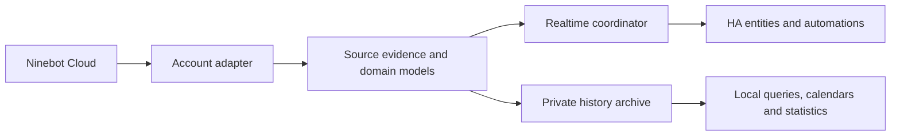

# Ninebot for Home Assistant

**Your vehicles, batteries and ride history — together in Home Assistant.**

English · [简体中文](README_zh.md)

[Install](#installation) · [History synchronization](#ride-history-and-track-synchronization) · [Documentation](docs/README.md) · [Roadmap](docs/roadmap.md)

Bring your Ninebot vehicles into everyday Home Assistant automations: monitor battery and charging, see vehicle status, synchronize ride history, detailed GPS tracks and trip metrics into private local storage.

> **2.0 prerelease · Independent community integration.** Designed for the Chinese Ninebot App service; other regions are unverified and not every vehicle model has been tested. Internet is required for cloud acquisition. Saved local history can be browsed without fetching the cloud.

## What you can do

| Capability | In Home Assistant |
|---|---|
| **Know your vehicle** | Main battery SOC, precise/estimated/AI range, charging, power, ACC, service information and device location. |
| **Understand the battery** | Voltage, temperature, supported cycles, charging power, health score, battery type/count and separate emergency communication SOC. |
| **Keep your rides** | Resumable first discovery, incremental synchronization, private local history/track evidence, storage quotas and quality-preserving geometry. |
| **Retain detailed information** | Ride times, distance, duration, energy, maximum/average speed and cloud-returned GPS points, with source precision and availability. |
| **Use native HA tools** | Ride calendars, completion events, response Actions and explicit day/month statistics imports for standard charts. |
| **Control with feedback** | Opt-in vehicle/seat locks and remote buttons, guarded dispatch and short-lived state confirmation. |

Fields depend on the model and actual reports. Health score is **not SOH**; rated energy is a specification. Missing evidence stays unknown rather than becoming a false zero. [Entities, units and options →](docs/guide.md#entities-and-data)

## Installation

### HACS — recommended

1. In HACS, open **⋮ → Custom repositories**.
2. Add `https://github.com/Wuty-zju/ha_ninebot` as **Integration**.
3. Download Ninebot and choose the desired **2.0 prerelease**; enable prerelease versions in the selector if needed.
4. Restart Home Assistant when prompted.
5. **Settings → Devices & services → Add integration → Ninebot**.

HACS must already be installed. This is a **custom repository**, not a claimed default-store listing.

### Manual installation

Download a [release](https://github.com/Wuty-zju/ha_ninebot/releases), copy `custom_components/ninebot` to `<config>/custom_components/ninebot`, restart HA and add the integration. All runtime/card assets are bundled; no separate service or card repository is needed.

**Compatibility:** HA **2026.1.0+**, a compatible 64-bit dependency wheel and access to the Chinese App cloud. ARMv7/32-bit is unsupported; other regions/platform combinations remain unverified. [Complete setup guide →](docs/guide.md)

## Add your accounts

Use password or two-step SMS login. Each account has a separate integration entry, session and archive. Reauth/reconfigure retain the established account. Passwords are not kept in ConfigEntry or passed in process arguments. SMS has offline coverage; live verification remains pending.

Options cover location, calendar, detail preservation/automatic sync, history budget/quota, controls/allowed vehicles, nominal battery parameters and debugging. New accounts enable preservation/sync; existing opt-outs are retained. Controls stay off until explicitly enabled. [Account and option details →](docs/guide.md#options)

## Ride history and track synchronization

Enable **Preserve trip details in background** and **Automatic history synchronization** in the account options. New accounts enable both; existing opt-outs remain unchanged.

- **First discovery, then incremental work:** resumable month/page scans discover available rides; later work reuses known records and fetches missing or changed details under a shared account budget.
- **Detailed ride records:** retain start/end times, distance, duration, energy, server maximum and calculated average speed where reported. Preserve source precision and distinguish missing fields from zero.
- **Detailed GPS evidence:** save cloud-returned full track points and associated sample data when available. New simplified/empty results do not overwrite a retained better route; no unverified coordinate conversion is applied.
- **Local structured archive:** raw business evidence and normalized facts stay in the private account archive, outside entity attributes/Recorder. Storage quotas pause writes rather than silently evicting history.
- **Progress and control:** per-vehicle progress, manual synchronization, pause/resume, budgeted retries and local integrity checks. Saved-detail progress covers discovered rides, not a guarantee of all cloud history.

Use native ride calendars and response Actions to query recorded information. [Synchronization, storage and query details →](docs/history.md#enable-preservation-and-synchronization)

Visualization, UI and custom cards are **early alpha**. They may be substantially redesigned, modified or withdrawn at any time and are not presented here as a stable product or demo.

## What's new in 2.0

The refactor separates account authentication, source evidence, normalized data, realtime updates and long-term history:

- **A stronger foundation:** isolated sessions, asynchronous managed I/O, demand/freshness groups, shared in-flight reads, bounded queues and backoff.
- **Purposeful HA models:** translated entities, separate ranges, native locks/calendars/events/images and response Actions; no entity per historical point.
- **History with a lifecycle:** resumable/incremental acquisition, facts alongside business evidence, geometry protection, backup hooks and bounded local verification/recovery.
- **A local query foundation:** bounded historical reads, source-aware detail chunks, scoped continuation versions and measured parsing reuse.
- **Reviewed upgrades and controls:** legacy identity migration, durable journals, explicit opt-in, one command per request and bounded readback.

[Upgrade and rollback →](docs/migration.md) · [Changelog →](CHANGELOG.md)

## How it works

Cloud acquisition and local browsing are separate. Entities update on bounded demand; historical details live privately, outside state attributes/Recorder. Only an explicit aggregate import writes native historical statistics. [Architecture and dependency disclosures →](docs/architecture.md)

## Privacy and limitations

- Location display defaults on: review the option. Preserved details/HA backups can contain precise routes; protect backups and automation traces.
- Online tiles default off. Enabling them sends visible map-area requests to OpenStreetMap. No unverified CRS conversion is applied.
- Point speed/distance units remain unverified; curves/playback use sequence. Maximum and overall average speed remain distinct.
- A saved-detail percentage, verified month or completed task is **not proof of all upstream history**. Simplified/lost cloud tracks cannot be recreated; local storage still has quota/disk limits.
- Controls require opt-in, allowlist and authorization. Vehicle/cloud enforces operating conditions; accepted commands/observed state are not physical guarantees. Seat locking is manual only.

[Troubleshooting →](docs/guide.md#troubleshooting) · [Coverage and statistics →](docs/history.md#coverage-and-statistics)

## Next steps

**Available now:** historical ride/detail/GPS synchronization, private structured storage, native calendars/statistics, response queries and bounded recovery.

**Under development:** early-alpha visualization/UI/cards that may be redesigned or withdrawn; clearer sync/coverage feedback, more evidence-backed entities/models and measured archive/read improvements.

**Research:** verified point metrics, spatial/geometry scaling and a more independently auditable protocol layer. These are directions, not delivery dates. [Full roadmap →](docs/roadmap.md)

## Support and contribute

Start with [documentation](docs/README.md) and [troubleshooting](docs/guide.md#troubleshooting). Use [Issues](https://github.com/Wuty-zju/ha_ninebot/issues) for reproducible bugs and [Discussions](https://github.com/Wuty-zju/ha_ninebot/discussions) for usage/design questions. Share versions and reviewed diagnostics, **never credentials or full private tracks**.

Contributors and coding agents: [contributing](CONTRIBUTING.md) · [development map](docs/development.md) · [AGENTS](AGENTS.md). Sensitive concerns: [security policy](SECURITY.md). Small changes use related offline checks; full compatibility runs are for major boundaries. The Checks badge does not claim every matrix job ran.

The downloads badge counts GitHub release-asset downloads across releases; it does not count HACS source-archive downloads or Git clones.

MIT licensed. Ninebot/Segway trademarks and images belong to their owners; this project has no official affiliation/support. Thanks to the HA/HACS community and protocol/library work acknowledged in [NOTICE](NOTICE), [architecture attribution](docs/architecture.md#dependencies-and-attribution) and bundled licenses.

Earlier README links

- [Installation and account](docs/guide.md)
- [Current data and options](docs/guide.md)
- [History, events and controls](docs/history.md)
- [Upgrade and development](docs/migration.md)
- [Missing local detail originals](docs/history.md)
- [Recent ride follow-up](docs/history.md)
- [History progress and local rate limiting](docs/history.md)
- [Reusing verified history months](docs/history.md)
- [Current-month source checks](docs/history.md)

