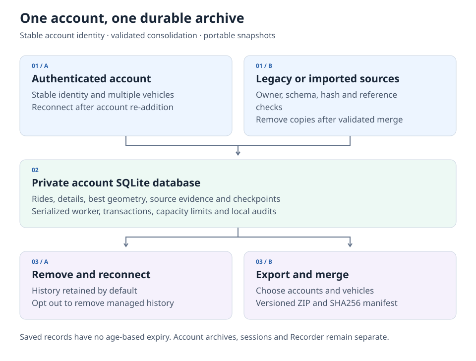

# Ninebot for Home Assistant

**Vehicle telemetry, local ride history and Home Assistant automations.**

English · [简体中文](README_zh.md)

<!-- ha-marketplace:exclude-start -->
   
<!-- ha-marketplace:exclude-end -->

[Install](#installation) · [Ride history](#ride-history-and-track-synchronization) · [Assistant](#ninebot-assistant) · [Guides](docs/README.md)

Bring a Ninebot vehicle into Home Assistant for battery and range readings, vehicle controls, ride statistics and a private route archive. Each account has its own vehicles, update schedule and SQLite database. Your dashboard, automations and optional Assistant can read the same saved rides.

Install the [stable release](https://github.com/Wuty-zju/ha_ninebot/releases/latest) for everyday use. The [2.2.10 preview](CHANGELOG.md#2210) distinguishes vehicles with the same name and keeps relative dates tied to the start of an Assistant query. If your host uses **Ninebot tasks**, check the [upgrade instructions](docs/assistant.md#upgrade-to-the-single-ninebot-api) before updating. [All releases](https://github.com/Wuty-zju/ha_ninebot/releases)

## What you can do

| Open | What you can do |
|---|---|
| Vehicle device page | Check main and communication battery charge, range, BMS readings and the last confirmed lock state. Available measurements depend on the vehicle. |
| Map and automations | Find the latest reported location, react to vehicle and ride events, and operate supported controls with state readback. |
| Ride archive | Look up yesterday’s rides, compare a month’s energy usage or recover a saved route. Keep data when removing and adding the same account. |
| Ride history card · early alpha | Filter by vehicle and date. Compare up to five routes on one map and replay recorded samples. |
| Ninebot Assistant · opt-in | Ask how far a vehicle travelled or why its history is incomplete. Read the value, its observation time, coverage and the supporting local record or public guide. |

## Installation

### Requirements

Home Assistant **2026.1.0 or newer**, a supported 64-bit runtime, and an account with vehicles visible in the Ninebot app. Authentication and live data require internet access. Saved rides can be read locally. The optional native Assistant tools require a compatible HA API and host. [Platform and account requirements](docs/guide.md#requirements)

Service-region and platform coverage are listed in the user guide.

<!-- ha-marketplace:exclude-start -->

### Marketplace · Home Assistant 2026.11 and newer

Install from the repository link today. In **Settings → Marketplace → ⋮ → Add from link**, connect GitHub if prompted and enter `Wuty-zju/ha_ninebot` as an **Integration**. Install the stable version and open Ninebot's account setup. Projects in the default catalog can be found through Marketplace search after you accept the Marketplace warning. [Marketplace installation guide](docs/guide.md#install-through-marketplace--ha-202611)

### HACS on older Home Assistant versions

1. Open **HACS → ⋮ → Custom repositories** and add `https://github.com/Wuty-zju/ha_ninebot` as an **Integration**.
2. Open **Ninebot**, download the stable release and restart when prompted.
3. Open **Settings → Devices & services → Add integration → Ninebot**.

### Manual installation

Download `ninebot.zip` from [the latest stable release](https://github.com/Wuty-zju/ha_ninebot/releases/latest). Extract it into `<config>/custom_components/ninebot/` with `manifest.json` directly in that directory. Restart Home Assistant and add Ninebot from **Devices & services**. The release includes `SHA256SUMS`.

<!-- ha-marketplace:exclude-end -->

### Upgrading from 1.x

Back up the Home Assistant configuration and private storage first. The 2.0 refactor introduced a new account model and moved some functions to native Lock entities. Check existing automations against the migration guide. Installations already on 2.x can update in place. [Migration and rollback](docs/migration.md)

## Add your accounts

Use **Settings → Devices & services → Add integration → Ninebot**. Sign in, then open **Configure** for the account. The Balanced preset, location and eligible vehicle controls are enabled on a new account. A vehicle must also be selected before control is available.

Enable the calendar and background history scan/detail acquisition when you want them. Enter rated battery values only if you know them. Account removal retains the local database by default. [All defaults and options](docs/guide.md#options)

## Ride history and track synchronization

A ride’s summary and its best known geometry are saved separately. A later correction can update the distance without replacing a detailed route with an endpoint pair. Verified month pages, shared account budgets and durable checkpoints let an interrupted scan pick up where it stopped. Browsing recorded rides reads the local archive.

| To see | Use |
|---|---|
| Today, yesterday, this month and the last ride | Native sensors. Use the optional calendar for dated entries and Statistics cards for imported aggregates. |
| Cross-month history for one or more vehicles | The dashboard ride library and its vehicle/date filters. Add rides with **+**, then choose the active vehicle and route from the map or its list. |
| A replay or a route comparison | **Play** or drag the sample slider. In 2.2.8, numbered map markers switch rides and **Selected rides total** combines the selected distance, duration and energy. |
| Detailed records for an automation | Use `ninebot.get_recorded_trips` and `ninebot.get_trip_detail` with the device and saved ride identity. |

A sampled route plays in saved point order. Older server details may contain only the start and end. Those points remain separate on the map. [Add the card, query history and interpret coverage](docs/history.md)

## Ninebot Assistant

Enable **Ninebot Assistant** for an account and select which data each vehicle may share. Choose the **Ninebot** collection in a compatible Assist conversation host or native MCP Server, or connect your MCP client to `/api/mcp/ninebot`. Automations can query the selected vehicle with `ninebot.ask` and an existing Home Assistant AI Task. The host chooses the model.

<picture>
  <source media="(prefers-color-scheme: dark)" srcset="docs/assets/architecture/assistant-en-dark.svg">
  
</picture>

| Ask | What supplies the answer |
|---|---|
| “What is this vehicle’s battery charge?” | One selected cached reading, its unit and observation time. |
| “How many rides did I take yesterday?” | The vehicle’s local business-day statistics and their coverage. |
| “Why is my monthly total unknown?” | A fixed sequence checks the statistic, archive progress and applicable help. Unknown causes remain open. |
| “How does map replay work?” | The versioned English or Chinese guide with a permanent source link. |

The eight query tools use cached vehicle data, local history and versioned help. The same collection can preview a history gap or request a bounded detail sync when the vehicle allows it. The original requester reviews the scope and request budget in the HA panel before approving the work. Assistant responses exclude precise coordinates and credentials. [Configure access and review tasks](docs/assistant.md)

## How it works

<picture>
  <source media="(prefers-color-scheme: dark)" srcset="docs/assets/architecture/overview-en-dark.svg">
  
</picture>

Vehicle state, BMS data, current-month travel and vehicle discovery have separate deadlines. On Balanced, a parked vehicle targets 60 seconds for both status and battery. Charging targets 15 and 30 seconds respectively. Active ACC targets 10 and 30 seconds. A control starts a short observation window. Concurrent entities share the same results. [Update profiles](docs/guide.md#update-speed) · [Control readback](docs/architecture.md#realtime-scheduling-and-controls)

## Your local ride database

<picture>
  <source media="(prefers-color-scheme: dark)" srcset="docs/assets/architecture/archive-en-dark.svg">
  
</picture>

Each account has a SQLite archive with rides, month membership, compressed source evidence and the best verified tracks. A page and its checkpoint commit together. The default budget is 60 logical history requests per account per hour, with 100 MiB of local storage. Local browsing leaves that request budget available for synchronization.

Export selected vehicles or accounts, or restore the same account after reinstalling. Import verifies ownership and merges overlapping records. Archive exports and HA backups can contain precise positions. [Export and recovery](docs/guide.md#export-and-import-history-databases) · [Storage contracts](docs/architecture.md#storage-and-integrity)

## Documentation and contribution

[Everyday guide](docs/guide.md) · [Ride archive and maps](docs/history.md) · [Assistant tools and permissions](docs/assistant.md) · [Upgrades and entity IDs](docs/migration.md)

For development, start with the source map and the narrowest relevant validation. The roadmap separates shipped behavior from proposals. [Architecture](docs/architecture.md) · [Development](docs/development.md) · [Contributor guide](CONTRIBUTING.md) · [Agent guide](AGENTS.md) · [Roadmap](docs/roadmap.md)

The Downloads badge counts downloads of the published `ninebot.zip` assets across releases. It includes repeat downloads and updates. [Download accounting](docs/development.md#package-download-audit)

## License and acknowledgements

Independently maintained under the MIT license. Ninebot and Segway names and imagery belong to their owners. [License](LICENSE) · [Acknowledgements](NOTICE) · [Security reports](SECURITY.md)
