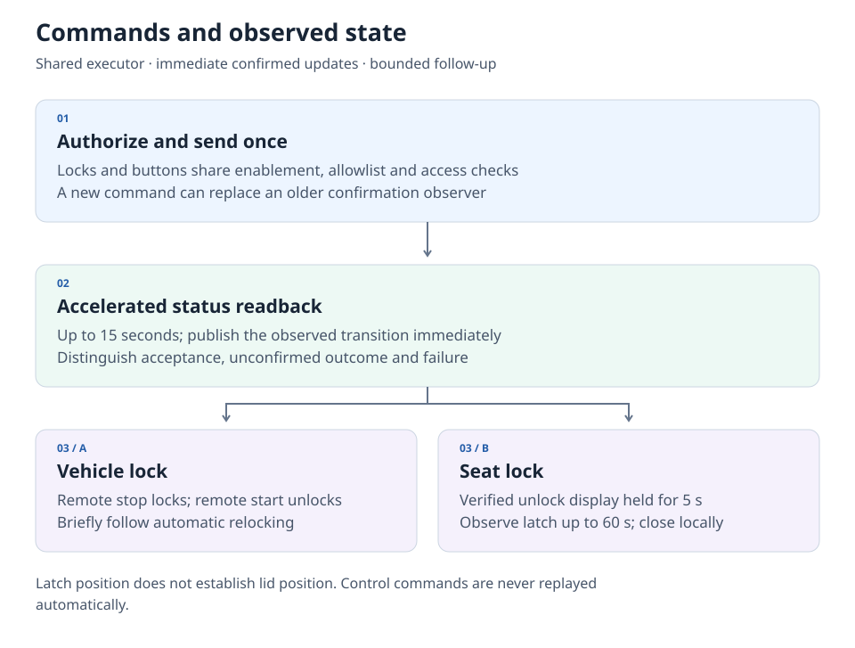

# Ninebot for Home Assistant

**Your vehicles, batteries and ride history — together in Home Assistant.**

English · [简体中文](README_zh.md)

     

[Install](#installation) · [Features](#what-you-can-do) · [Ride history](#ride-history-and-track-synchronization) · [Architecture](#how-it-works) · [Documentation](docs/README.md)

Monitor your Ninebot's battery, charging and vehicle status. Keep ride records and detailed GPS tracks in your own Home Assistant storage, query them from automations, and use native calendars and statistics alongside everyday vehicle entities.

> **2.0 is currently a prerelease.** This independent community integration connects to the Chinese Ninebot App service. Cloud acquisition needs internet access; saved history is available through local queries. Visualization and custom cards remain early alpha.

## What you can do

| Area | Available information and features |
|---|---|
| **Vehicle** | Power, ACC, charging, main-battery presence/type/count, smart-service status and device location. |
| **Range** | Separate precise, estimated and AI range values; AI range appears in diagnostics. |
| **Main battery** | SOC, measured voltage, temperature, cycle count/support, charging power, health score and Find My support where reported. |
| **Communication battery** | Separate emergency communication battery SOC; main battery SOC remains the device's battery indicator. |
| **Ride summaries** | Today/yesterday/month distance, count, duration and energy; Last Ride times, distance, duration, maximum/average speed and energy intensity. |
| **Historical archive** | Resumable discovery, incremental updates, detailed ride/GPS preservation, local query Actions and per-vehicle progress. |
| **Native HA features** | Ride calendar, completion events, GPS tracker, vehicle image, response Actions and explicit day/month statistics imports. |
| **Controls** | Vehicle lock, seat unlock, bell and retained remote-start/stop buttons, with fresh status checks after commands. |

Available fields vary by vehicle and cloud reports. Battery health score is a score, not SOH; configured rated energy is a specification, not measured capacity. [Entities, units and availability →](docs/guide.md#entities-and-data)

## Installation

### Requirements

- **Home Assistant 2026.1.0+** and a compatible **64-bit** host/container for the runtime dependency.
- A Ninebot account with vehicles visible in the **Chinese Ninebot App service**.
- Internet access for login, live updates and cloud history acquisition.
- HACS for the recommended installation; manual installation is also supported.

ARMv7/32-bit platforms are unsupported. [Platform and region details →](docs/guide.md#requirements)

### HACS — recommended

1. Open **HACS → ⋮ → Custom repositories**.
2. Add `https://github.com/Wuty-zju/ha_ninebot` with category **Integration**.
3. Open **Ninebot**, select a **2.0 prerelease**, and download it. Enable prerelease versions in the selector if needed.
4. Restart Home Assistant when prompted.
5. Go to **Settings → Devices & services → Add integration → Ninebot**.

This repository currently uses **HACS custom-repository installation**. HACS must already be installed.

### Manual installation

Download `ninebot.zip` from the chosen [packaged release](https://github.com/Wuty-zju/ha_ninebot/releases), create `<config>/custom_components/ninebot`, and extract the ZIP contents there. Restart Home Assistant and add Ninebot from Devices & services. For older releases or GitHub source archives, copy the contained `custom_components/ninebot` directory instead.

Runtime code, translations and bundled resources live in that directory. HA installs the declared dependencies; no separate daemon or dashboard repository is required.

The Downloads badge counts `ninebot.zip` downloads across releases, including updates and repeat downloads. It does not represent unique installations or historical source-archive downloads.

### Upgrading from 1.x

2.0 rebuilds authentication, entity management and history storage. Back up your HA configuration, storage and database, then follow the [migration guide](docs/migration.md). Entity-ID and Lock-platform migrations can require automation/dashboard updates. Storage rollback requires the matching pre-upgrade backup.

## Add your accounts

Sign in with your account and **password**; vehicle features are configured after authentication. Ninebot discovers the account's vehicles and creates supported entities. Review account options, then add another integration entry for each additional account.

Each account owns its session, credentials directory and archive. Entry titles use the reported **username and account**, omitting missing components. Reauthentication and reconfiguration update the established account. Passwords are not stored in ConfigEntry or passed as process arguments; local session tokens and backups should be protected.

### Choose what runs

| Option | Default | Purpose |
|---|---|---|
| Precise location | On | Current position and authorized track responses; no separate precision request. |
| Ride calendar | On | Local rides on a native HA calendar. |
| Background detail preservation | On for new accounts | Save detailed rides/tracks within the request budget. |
| Automatic history sync | On for new accounts | Initial discovery and subsequent incremental work. |
| Controls and vehicle allowlist | Off / empty | Explicitly enable commands for selected vehicles. |
| Debug mode | Off | Bounded parsed current information for investigation. |

Existing explicit choices are retained on upgrade. Further options include polling intervals, nominal battery parameters, request budget and archive quota. [Defaults and ranges →](docs/guide.md#options)

## Ride history and track synchronization

### What is saved

The private account archive keeps normalized facts alongside retained business-source evidence:

- Ride identity, source month, start/end times, distance, duration and energy.
- Server maximum speed and the separate overall average calculated from distance/duration.
- Detailed GPS trails and associated point/sample fields when returned by the cloud.
- Monthly summaries, page receipts, capture times, source precision and field availability.
- Synchronization checkpoints, retries, coverage and local integrity results.

Scalar values and track quality have separate lifecycles. A corrected total can update while a more complete route is retained; later empty or simplified responses do not erase a better saved track.

### How synchronization progresses

Enable **Preserve trip details in background** and **Automatic history synchronization** in account options. Both default on for new accounts.

| Stage | Work performed |
|---|---|
| **Initial discovery** | Walk month/page plans, validate counts and identities, deduplicate rides and persist checkpoints. |
| **Detail preservation** | Fetch missing or unsettled details, reuse stable records and prioritize older rides near the preservation risk window. |
| **Incremental updates** | Revisit recent activity, reconcile changed lists and retry gaps without repeatedly downloading settled history. |
| **Local verification** | Check retained objects and page relationships in bounded work; surface actionable storage problems through Repairs. |

Sync status, month-scan progress, saved-detail progress and last-success entities explain different stages. Manual sync, pause and resume are available. Saved-detail percentage covers **discovered records**; month coverage reports list gaps separately.

The default history budget is **60 logical requests per account/hour**, configurable up to **120**. Archive quota defaults to **100 MiB per account**, configurable from **32–2048 MiB**. Reaching the quota pauses writes and retains existing data. Local records have no age-based expiry; capacity and backups govern long-term retention. Save details while the cloud still returns them: removed or simplified upstream tracks cannot be recreated locally.

### Use the recorded information

| Goal | Home Assistant feature |
|---|---|
| Current position | Device location tracker and native Map card. |
| Rides by date | Native ride Calendar backed by the local archive. |
| New-ride automation | Ride-completed Event entity, after its startup baseline. |
| Saved rides/tracks | `ninebot.get_recorded_trips` and `ninebot.get_trip_detail`. |
| Day/month aggregates | `ninebot.get_statistics`. |
| Historical trend charts | Explicit `ninebot.import_statistics`, then native statistics charts. |
| Acquisition management | `ninebot.sync_history` and history entities/buttons. |

Local-only query modes read the archive without cloud acquisition. Large lists and trails use bounded pages/chunks, rather than entity attributes or one entity per ride.

[History guide and Action examples →](docs/history.md) · [Coverage and statistics →](docs/history.md#coverage-and-statistics)

**Visualization status:** bundled map/UI/cards are **early alpha** and may be redesigned or withdrawn. Current experimental instructions remain in the [history guide](docs/history.md#add-the-history-map). This README focuses on data synchronization and preservation; interface screenshots are not presented as a finished product or demo.

## What's new in 2.0

| Layer | Refactor and resulting behavior |
|---|---|
| **Accounts** | Separate entries, sessions and archives; password setup, reauth and reconfigure. |
| **Data model** | Reviewed normalization, source metadata, distinct range fields, explicit missing values and original precision. |
| **Realtime updates** | Per-vehicle/group freshness, demand scheduling, shared in-flight reads, partial failures and backoff. |
| **History lifecycle** | Resumable discovery, incremental detail preservation, transactional SQLite storage and quality-aware track retention. |
| **HA integration** | Native sensors, locks, tracker, images, calendars and events; response Actions and aggregate statistics. |
| **Maintenance** | Diagnostics, Repairs, migration journals, backup coordination and bounded local verification/reconstruction. |

Retired low-confidence SOC energy estimates remain removed. Cloud readings and useful configured specifications have distinct roles. [Migration details →](docs/migration.md) · [Release history →](CHANGELOG.md)

## How it works

### Live state and history have separate lifecycles

Each account owns its session/resources. A shared scheduler coordinates cloud reads across vehicles: current state refreshes by data group, while history advances in background steps. Source evidence and normalized values remain distinguishable.

Typical schedules are **120 s for status**, **600 s for battery/travel** and **3600 s for profiles**, subject to enabled features, freshness and backoff. Identical in-flight reads share work; there is no cloud poll per entity.

### History is acquired once, then reused locally

Month discovery, identity, detail download and local verification have independent checkpoints. Stable details are reused; newer scalar values and the best known geometry are kept separately. An account-owned serialized worker performs SQLite operations outside HA's event loop.

Current summaries use HA's state machine. Full trails and business evidence stay private. Native long-term statistics receive selected day/month aggregates through an explicit import; they are not a second GPS database.

### Controls confirm state through fresh observations

Locks and buttons share the executor. Vehicle lock/unlock maps to remote stop/start; vehicle/cloud operating rules apply. HA follows with short-term status reads rather than assuming the target state. Seat unlock is remote; seat locking is manual.

The authenticated local protocol client is managed automatically. Paginated history uses a dedicated adapter with the same account session. [Technical architecture, lifecycle and dependencies →](docs/architecture.md)

## Privacy and data meaning

- **Location and archives:** location defaults on. Details and HA backups can contain precise routes; requested GPS responses may appear in automation traces.
- **Reported versus calculated:** range fields stay separate; maximum and overall average speed differ. Unknown point units/coordinate systems are not silently converted.
- **Map resources:** experimental cards bundle JavaScript and the map library. Optional external basemap tiles default off and contact the tile provider when enabled.
- **Access and diagnostics:** archives are account-isolated, history responses check vehicle access, and diagnostics expose reviewed metadata instead of credentials or full trails.

[Privacy and troubleshooting →](docs/guide.md#privacy-backup-and-removal) · [Backup and recovery →](docs/history.md#verification-and-recovery)

## Next steps

| Area | Direction |
|---|---|
| **History visualization** | Develop the early-alpha map/UI/card foundation into clearer date/vehicle navigation, route comparison and linked detail/chart views. |
| **HA dashboards** | Improve calendar/statistics workflows and reusable dashboard examples. |
| **Data coverage** | Add useful entities and vehicle/battery models as field semantics are confirmed. |
| **Storage and synchronization** | Refine reads, incremental acquisition, progress and recovery using measured workloads. |
| **Protocol research** | Verify point metrics and keep protocol replacement possible behind the backend abstraction. |

These are development directions rather than release-date commitments. [Detailed roadmap →](docs/roadmap.md)

## Documentation and contribution

| You need | Start here |
|---|---|
| Install, connect an account or change options | [Setup and everyday use](docs/guide.md) |
| Query history, use statistics or explore experimental maps | [History, maps and statistics](docs/history.md) |
| Upgrade or restore a backup | [Migration guide](docs/migration.md) |
| Understand the implementation | [Architecture](docs/architecture.md) |
| Contribute code or work with coding agents | [Contributing](CONTRIBUTING.md), [development map](docs/development.md), [AGENTS](AGENTS.md) |

Use [Issues](https://github.com/Wuty-zju/ha_ninebot/issues) for reproducible bugs and [Discussions](https://github.com/Wuty-zju/ha_ninebot/discussions) for usage/design questions. Include integration/HA versions and relevant diagnostics after reviewing privacy. Sensitive concerns follow the [security policy](SECURITY.md).

## License and acknowledgements

[MIT licensed](LICENSE). Ninebot/Segway names and vehicle images belong to their owners; this project is independently maintained. Community protocol/library contributions and bundled licenses are recorded in [NOTICE](NOTICE) and [dependency attribution](docs/architecture.md#dependencies-and-attribution).

Earlier README links

- [Installation and account](docs/guide.md)
- [Current data and options](docs/guide.md)
- [History, events and controls](docs/history.md)
- [Upgrade and development](docs/migration.md)
- [Missing local detail originals](docs/history.md)
- [Recent ride follow-up](docs/history.md)
- [History progress and local rate limiting](docs/history.md)
- [Reusing verified history months](docs/history.md)
- [Current-month source checks](docs/history.md)
- [Support and contribute](#documentation-and-contribution)
- [Privacy and limitations](#privacy-and-data-meaning)

