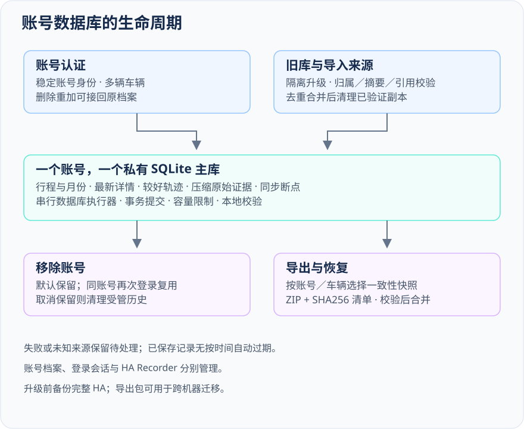
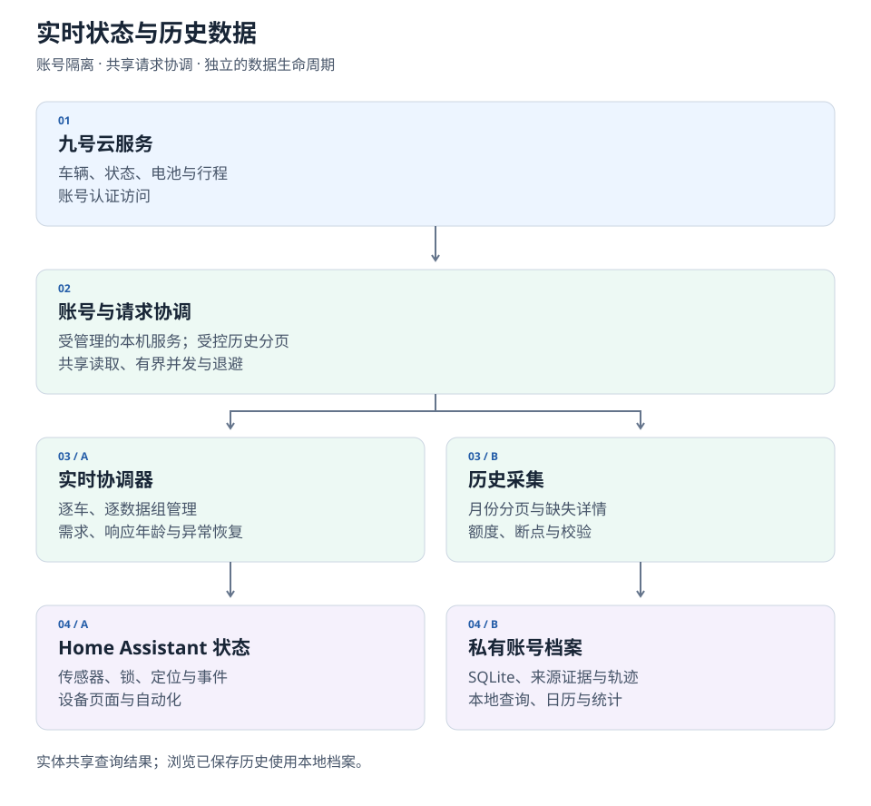
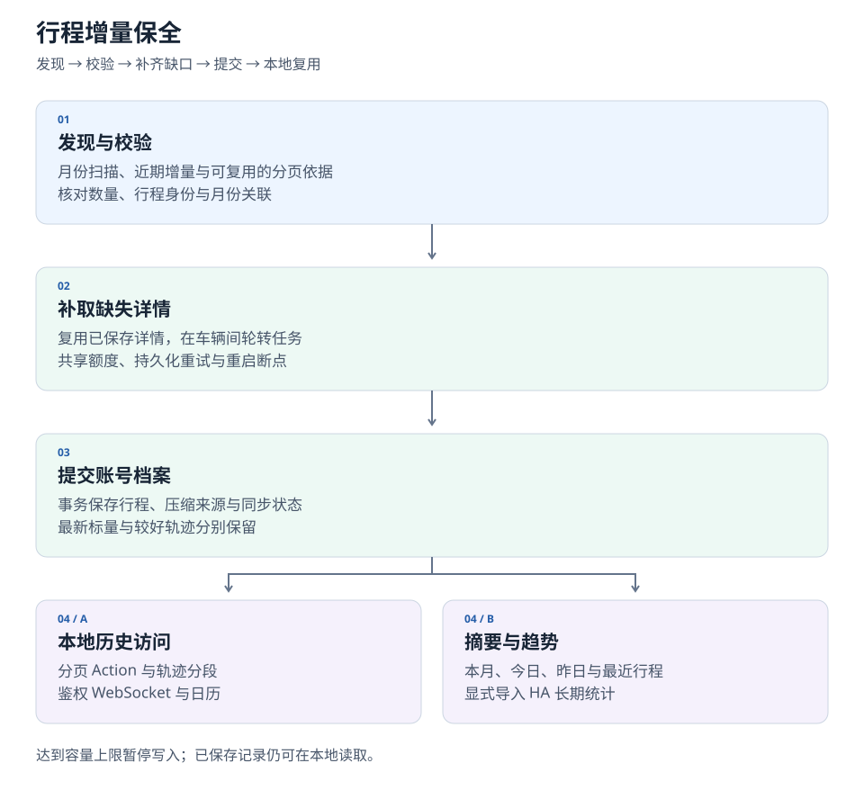
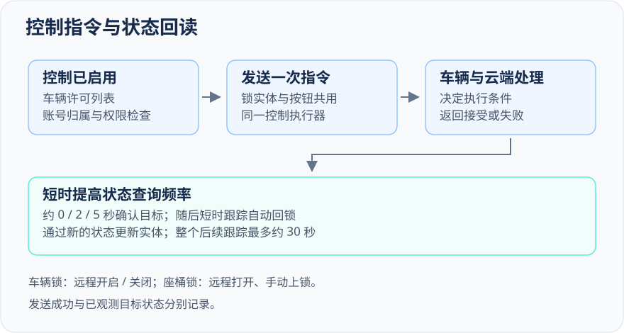

# Ninebot for Home Assistant

**在 Home Assistant 中管理九号车辆、电池与骑行历史。**

[English](README.md) · 简体中文

    

[安装](#安装) · [功能](#可以做什么) · [骑行历史](#历史行程轨迹与详情同步) · [架构](#工作原理) · [文档](docs/README.md)

查看九号车辆的电量、充电与状态，将骑行记录及精细 GPS 轨迹保存在自己的 Home Assistant 存储中，通过自动化查询历史，并使用原生日历、统计与日常车辆实体。

> **当前推荐候选：[v2.0.0rc2](https://github.com/Wuty-zju/ha_ninebot/releases/tag/v2.0.0rc2)。** 实时更新需要互联网，已保存行程可在本地查询。地图可视化与自定义卡片为早期 alpha。

## 可以做什么

| 分类 | 已有信息与功能 |
|---|---|
| **车辆** | 上电、ACC、充电、主电池存在/类型/组数、智能服务状态和设备位置。 |
| **续航** | 独立的精准续航、预估续航和 AI 续航；AI 续航位于诊断区域。 |
| **主电池** | 电量、实测电压、温度、循环次数及支持状态、充电功率、健康评分，以及上游上报的 Find My 支持。 |
| **通信电池** | 独立的应急通信电池电量；设备电量指示仍关联主电池。 |
| **骑行摘要** | 今日、昨日、本月的里程、次数、时长及能耗；最近行程的起止时间、里程、时长、最高/平均速度和单位里程能耗。 |
| **历史档案** | 可续接的首次发现、增量更新、行程/GPS 详情保全、本地查询操作和逐车进度。 |
| **HA 原生能力** | 行程日历、车辆／行程事件、GPS 定位、车辆图片、响应型 Actions，以及显式日/月统计导入。 |
| **控制** | 车辆锁、座桶解锁、鸣笛及保留的远程开启/关闭按钮，操作后回读最新状态。 |

可用字段取决于车型及云端上报。电池健康评分不是 SOH，配置的额定能量是规格值，不是实测容量。[实体含义、单位及可用性 →](docs/guide_zh.md#实体与数据)

## 安装

### 环境要求

- **Home Assistant 2026.1.0+**，以及兼容运行依赖的 **64 位**主机或容器。
- 在官方 App 中可以看到车辆的九号账号。
- 登录、实时更新及云端历史采集所需的互联网访问。
- 推荐使用 HACS，也支持手动安装。

不支持 ARMv7/32 位平台。[平台和地区详情 →](docs/guide_zh.md#环境要求)

### HACS — 推荐

1. 打开 **HACS → ⋮ → 自定义存储库**。
2. 添加 `https://github.com/Wuty-zju/ha_ninebot`，类别选择 **Integration**。
3. 打开 **Ninebot**，选择 **v2.0.0rc2**（必要时开启预发布显示）并下载。
4. 按提示重启 Home Assistant。
5. 前往 **设置 → 设备与服务 → 添加集成 → Ninebot**。

目前通过 **HACS 自定义仓库**安装，需要预先安装 HACS。

### 手动安装

从所选[安装包版本](https://github.com/Wuty-zju/ha_ninebot/releases)下载 `ninebot.zip`，创建 `<config>/custom_components/ninebot`，将 ZIP 内容解压至该目录。重启 Home Assistant，然后从设备与服务中添加 Ninebot。旧版本或 GitHub 源码压缩包则复制其中的 `custom_components/ninebot` 目录。

运行代码、翻译和随附资源均位于该目录。HA 会安装声明的依赖，无需另行部署守护服务或仪表盘仓库。

Downloads 徽章累计各版本 `ninebot.zip` 的下载次数，包括升级和重复下载，不代表独立安装用户数，也不包含过去的源码包下载。

### 从 1.x 升级

2.0 重构了认证、实体管理和历史存储。请备份 HA 配置、存储及数据库，再按照[迁移指南](docs/migration_zh.md)操作。实体 ID 及 Lock 平台迁移可能需要更新自动化和仪表盘；存储回退需使用匹配的升级前备份。

## 添加账号

使用账号和**密码**登录，验证后配置车辆功能。集成发现该账号下的车辆并创建受支持实体。检查账号选项，如需连接其他账号，再添加一个集成条目。

各账号拥有独立会话、凭据目录和档案。条目标题使用实际上报的**用户名与账号**，缺失部分省略。重新认证与重新配置更新原账号。密码不存入 ConfigEntry，也不通过进程参数传递；本地会话令牌与备份仍需妥善保管。

### 选择运行功能

| 选项 | 默认 | 用途 |
|---|---|---|
| 刷新速度 | 均衡 | 五档自适应；旧自定义周期保持不变，直到主动换档。 |
| 精确位置 | 开启 | 显示当前位置及授权轨迹响应，不增加独立精度查询。 |
| 行程日历（Beta） | 新账号关闭 | 在 HA 原生日历中显示本地行程。 |
| 自动同步历史详情（Beta） | 新账号关闭 | 在请求预算内保存行程和轨迹详情。 |
| 自动扫描历史行程（Beta） | 新账号关闭 | 首次发现及后续增量任务。 |
| 控制及车辆许可列表 | 新账号开启 / 登录核验的全部车辆 | 已有选择保留，后续新增车辆不自动批准。 |
| 保留本地历史数据库（Beta） | 开启 | 删除账号后保留，重新登录同账号接回。 |
| 车辆事件（Beta） | 开启 | 行程上报、修订、完成与具体车辆状态转换。 |
| 调试模式 | 关闭 | 显示有界的当前解析信息，方便排查。 |

升级保留已有明确选择。其他选项包括刷新周期、电池标称参数、请求预算及档案配额。[默认值与范围 →](docs/guide_zh.md#配置选项)

## 历史行程、轨迹与详情同步

### 保存哪些信息

账号私有档案同时保存规范化事实和留存的业务来源依据：

- 行程身份、来源月份、起止时间、里程、时长及能耗。
- 服务端最高速度，以及独立按里程/时长计算的全程平均速度。
- 云端返回的精细 GPS 轨迹，以及相关逐点/采样字段。
- 月摘要、分页收据、采集时间、来源精度及字段可用状态。
- 同步断点、重试、覆盖信息和本地完整性结果。

标量与轨迹质量分别维护。更新后的合计可以被接收，同时保留此前更完整的路线；后续空响应或简化响应不会抹掉较好的已存轨迹。

### 同步如何推进

在账号选项中开启**自动同步历史详情（Beta）**和**自动扫描历史行程（Beta）**。新账号默认关闭，已有选择保留。

| 阶段 | 执行内容 |
|---|---|
| **首次发现** | 遍历月份/分页任务，核对数量及身份，去重行程并持久保存断点。 |
| **详情保全** | 获取缺失或尚未稳定的详情，复用稳定记录，优先处理接近保全风险窗口的旧行程。 |
| **增量更新** | 复核近期活动、核对变化列表并重试缺口，不反复下载已稳定历史。 |
| **本地校验** | 分批检查原件与分页关系，需处理的存储问题通过 Repairs 提示。 |

历史行程扫描与详情保存进度位于设备诊断；同步按钮可启动或恢复任务，暂停按钮停止后台采集。调试模式增加同步状态和最近成功时间。详情百分比针对**已发现记录**，月份覆盖另行标明列表缺口。

历史请求预算默认每账号每小时 **60 次逻辑请求**，通过数字输入框配置为 **1–120 次**，填写 **0** 则取消每小时配额（不推荐），请求串行、重试与云端退避仍然生效；档案默认每账号 **100 MiB**，可配置为 **32–2048 MiB**。达到配额时暂停写入并保留已有数据。本地记录不按年龄自动过期，长期保存取决于容量和备份。应在云端仍返回详情时完成保全，已简化或移除的上游轨迹无法在本地重建。

### 使用已存信息

| 目标 | Home Assistant 能力 |
|---|---|
| 当前位置 | 设备位置定位实体及 HA 原生地图卡。 |
| 按日期查看骑行 | 基于本地档案的原生行程日历。 |
| 新行程自动化 | 建立启动基线后的车辆／行程事件实体。 |
| 已存行程/轨迹 | `ninebot.get_recorded_trips` 和 `ninebot.get_trip_detail`。 |
| 日/月汇总 | `ninebot.get_statistics`。 |
| 历史趋势图表 | 显式执行 `ninebot.import_statistics`，再使用原生统计图表。 |
| 管理历史采集 | `ninebot.sync_history` 及历史实体、按钮。 |

本地专用查询模式读取档案，不触发云端采集。大列表和轨迹以有界分页/分段返回，不写入实体属性，也不会为每趟行程创建实体。

[历史指南及操作示例 →](docs/history_zh.md) · [覆盖与统计 →](docs/history_zh.md#覆盖与统计)

**可视化状态：**随附地图和卡片为**早期 alpha**，将继续完善导航、联动视图与轨迹对比。[历史指南](docs/history_zh.md#添加历史地图)提供当前安装方法。

## 2.0 重构内容

| 层次 | 重构与当前行为 |
|---|---|
| **账号** | 独立条目、会话及档案；密码登录、重新认证和重新配置。 |
| **数据模型** | 经核对的规范化、来源元数据、独立续航字段、明确缺报及原始精度。 |
| **实时更新** | 逐车/数据组新鲜度、按需调度、共享在途读取、部分失败及退避。 |
| **历史生命周期** | 可续接发现、详情增量保全、事务化 SQLite 存储及轨迹质量保护。 |
| **HA 接入** | 原生传感器、锁、定位、图片、日历和事件，响应型操作及聚合统计。 |
| **维护** | 诊断、Repairs、迁移记录、备份协调及有界本地校验/重建。 |

重构还加入了车辆发现快速恢复、状态即时更新、跨天统计保留，以及删除并重新添加账号后的历史库复用。电池配置规格与实测值分别表达。[迁移详情 →](docs/migration_zh.md) · [2.0 开发回顾 →](docs/releases/2.0.md#简体中文) · [版本历史 →](CHANGELOG.md)

## 本地行程数据库

每个已认证账号拥有**一个私有 SQLite 数据库**，供该账号的多辆车共用，并独立于集成条目保存。结构化记录方便查询，压缩的来源证据用于校验和后续解析。

| 能力 | 实现方式 |
|---|---|
| **长期保留** | 无按年龄自动删除。默认移除账号仍保留历史，再次登录同账号自动接回。 |
| **增量采集** | 月份／分页断点、行程 ID 去重和详情复用减少重复请求，重启后继续执行。 |
| **轨迹保护** | 最新标量与较好轨迹分别选择，新简化路线到达后仍保留已有详细轨迹。 |
| **高效读取** | 数据库操作在事件循环外串行执行；本地查询分页、轨迹分段，实时轮询单独调度。 |
| **校验与恢复** | 事务、响应摘要、引用检查、有界审计及受支持的重建流程保护已有记录。 |
| **导出与迁移** | 选定车辆或账号导出版本化 ZIP；导入先核验归属、结构和响应，再去重合并。 |
| **升级清理** | 校验后整合旧库，成功合并的副本自动清理；不同来源证据保留在主库内。 |
| **容量管理** | 达到账号额度时暂停写入，已有记录仍可使用，用户可提高上限。 |

<picture>
  <source media="(prefers-color-scheme: dark)" srcset="docs/assets/architecture/archive-zh-dark.svg">
  
</picture>

**保留本地历史行程信息数据库（Beta）**默认开启，决定移除账号时的处理。管理员可在账号**配置**中导出／导入；下载链接十分钟失效，文件名区分 UTC 时间、账号／车辆数与导出范围。

大版本升级前请备份 Home Assistant。首次升级存在多个旧库时，校验和合并可能需要数分钟。导出包包含私人位置记录，请妥善保存。[导出／导入说明 →](docs/guide_zh.md#导出和导入历史数据库) · [升级与回退 →](docs/migration_zh.md#存储升级与回滚)

## 工作原理

### 实时状态与历史采用独立生命周期

<picture>
  <source media="(prefers-color-scheme: dark)" srcset="docs/assets/architecture/overview-zh-dark.svg">
  
</picture>

各账号管理自己的会话和资源。共享调度器协调多车云端读取：当前状态按数据组刷新，历史分批在后台推进，来源依据与规范化数值保持可区分。

均衡档停车时**状态／BMS为60／60秒**，充电时**15／30秒**，ACC活跃时**10／30秒**；当前月行程汇总停车／活跃时为**600／120秒**，车辆资料每小时更新。每辆车、每组数据独立调度，共享响应并遵循失败退避。[五档刷新速度与具体行为 →](docs/guide_zh.md#刷新速度)

### 历史按需采集，随后本地复用

<picture>
  <source media="(prefers-color-scheme: dark)" srcset="docs/assets/architecture/history-zh-dark.svg">
  
</picture>

月份发现、身份、详情下载和本地校验分别保存断点。稳定详情会被复用，较新标量与最佳已知几何独立保存。SQLite 操作由账号拥有的串行执行器在 HA 事件循环之外处理。

当前摘要使用 HA 状态机，完整轨迹与业务依据保留在私有存储。原生长期统计通过显式导入接收选定日/月聚合，不另存完整 GPS 数据。

### 控制通过新状态确认

<picture>
  <source media="(prefers-color-scheme: dark)" srcset="docs/assets/architecture/controls-zh-dark.svg">
  
</picture>

锁与按钮共用执行器。车辆上锁/解锁映射为远程关闭/开启，执行条件由车辆和云端判断。HA 随后短时查询状态，不直接假定目标已达成。座桶支持远程打开，上锁仍需手动完成。

经过鉴权的本地协议客户端由集成自动管理；历史分页使用专用适配器，复用同一账号会话。[技术架构、生命周期及依赖 →](docs/architecture.md)

## 隐私与数据含义

- **位置与档案：** 默认开启位置。详情及 HA 备份可能包含精确路线，请求的 GPS 响应也可能进入自动化 trace。
- **上报与计算：** 三种续航独立，最高速度与全程平均速度分别处理，不擅自转换未知逐点单位或坐标系。
- **地图资源：** 实验卡片随集成提供 JavaScript 和地图库。可选外部底图默认关闭，开启后会请求底图提供方。
- **访问与诊断：** 账号档案隔离，历史响应校验车辆访问权限，诊断只提供经审核元数据，不包含凭据或完整轨迹。

[隐私与排障 →](docs/guide_zh.md#隐私备份与移除) · [备份与恢复 →](docs/history_zh.md#校验与恢复)

## 后续方向

| 分类 | 方向 |
|---|---|
| **历史可视化** | 基于早期 alpha 地图/界面/卡片，完善日期及车辆导航、路线比较和联动详情/图表。 |
| **HA 仪表盘** | 完善日历/统计工作流及可复用仪表盘示例。 |
| **数据覆盖** | 根据已确认字段语义，增加有价值的实体及车型/电池适配。 |
| **存储与同步** | 根据测量优化读取、增量采集、进度及恢复。 |
| **协议研究** | 核实逐点指标，并通过后端抽象保留协议替换空间。 |

这些是开发方向，不代表发布日承诺。[详细路线 →](docs/roadmap.md)

## 文档与贡献

| 需要 | 入口 |
|---|---|
| 安装、连接账号或修改选项 | [安装与日常使用](docs/guide_zh.md) |
| 查询历史、使用统计或体验实验地图 | [历史、地图与统计](docs/history_zh.md) |
| 升级或恢复备份 | [迁移指南](docs/migration_zh.md) |
| 理解实现 | [架构](docs/architecture.md) |
| 贡献代码或使用 coding agent | [贡献说明](CONTRIBUTING.md)、[开发导航](docs/development.md)、[AGENTS](AGENTS.md) |

可复现问题请提 [Issue](https://github.com/Wuty-zju/ha_ninebot/issues)，使用和设计讨论请前往 [Discussions](https://github.com/Wuty-zju/ha_ninebot/discussions)。提供集成/HA 版本及相关、已检查隐私的诊断；敏感问题通过[安全政策](SECURITY.md)反馈。

## 许可证与致谢

采用 [MIT 许可证](LICENSE)。Ninebot/Segway 名称及车辆图片归相应权利人所有，本项目独立维护。社区协议/依赖贡献和随附许可证见 [NOTICE](NOTICE) 及[依赖归属](docs/architecture.md#dependencies-and-attribution)。

旧 README 入口

- [安装与账号](docs/guide_zh.md)
- [当前数据与选项](docs/guide_zh.md)
- [行程、事件与控制](docs/history_zh.md)
- [升级与开发](docs/migration_zh.md)
- [缺失本地详情原件](docs/history_zh.md)
- [近期行程收尾](docs/history_zh.md)
- [历史同步进度与本地限速](docs/history_zh.md)
- [复用已核验历史月份](docs/history_zh.md)
- [当前月份来源校验](docs/history_zh.md)
- [支持与贡献](#文档与贡献)
- [隐私与限制](#隐私与数据含义)

