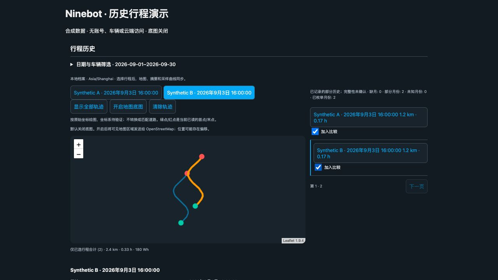
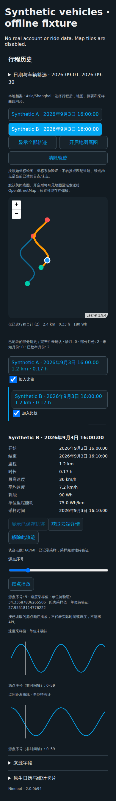
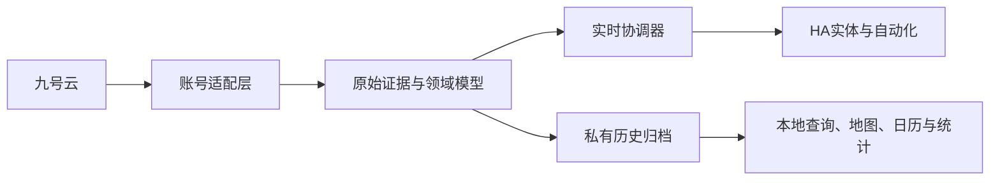

<div align="center">

# Ninebot for Home Assistant

**在 Home Assistant 中管理九号车辆、电池与骑行历史。**

[English](README.md) · 简体中文

[](https://github.com/Wuty-zju/ha_ninebot/releases)
[](docs/guide_zh.md#环境要求)
[](https://my.home-assistant.io/redirect/hacs_repository/?owner=Wuty-zju&repository=ha_ninebot&category=integration)
[](https://github.com/Wuty-zju/ha_ninebot/actions/workflows/checks.yaml)
[](LICENSE)

[安装](#安装) · [历史地图](#在地图上探索骑行历史) · [文档](docs/README.md) · [开发方向](docs/roadmap.md)

</div>

让九号车辆参与日常 HA 自动化：查看电量、充电与车辆状态，本地保全骑行记录，并通过联动地图探索历史路线。

> **2.0 预发布 · 独立社区集成。** 面向中国区 App 服务，未验证所有车型/其他地区。云端采集需互联网，已有本地历史可不抓云浏览。



*真实随包卡片与合成数据。地图、列表、摘要和采样曲线共享选择，演示未开启在线底图。*

## 可以做什么

| 能力 | HA 中的表现 |
|---|---|
| **了解车辆** | 主电池电量、精准/预估/AI 续航、充电、上电、ACC、智能服务和设备位置。 |
| **了解电池** | 电压、温度、支持的循环次数、充电功率、健康评分、电池类型/数量和独立通信电量。 |
| **留住历史** | 可重启续接的首次发现、增量同步、私有历史/轨迹证据、空间限额与较好几何保护。 |
| **浏览与比较** | 最新优先日期导航、跨车最多五趟、地图/列表/摘要/曲线联动、点焦点与序号播放。 |
| **HA 原生能力** | 行程日历、骑行事件、响应 Action、显式日/月统计导入与标准图表。 |
| **控制与反馈** | 主动启用车辆锁/座桶锁和远程按钮，经归属检查、短期回读确认。 |

字段受车型/实际上报影响，健康评分**不是 SOH**，额定能量是规格。缺证据保持未知，不伪装成 0。[实体、单位与选项 →](docs/guide_zh.md#实体与数据)

## 安装

### HACS：推荐方式

1. HACS **⋮ → 自定义仓库**。
2. 添加 `https://github.com/Wuty-zju/ha_ninebot`，类型 **集成 Integration**。
3. 下载 Ninebot，选择所需 **2.0 prerelease**，必要时开启预发布版本选择。
4. 按提示重启 HA。
5. **设置 → 设备与服务 → 添加集成 → Ninebot**。

[](https://my.home-assistant.io/redirect/hacs_repository/?owner=Wuty-zju&repository=ha_ninebot&category=integration)
[](https://my.home-assistant.io/redirect/config_flow_start/?domain=ninebot)

需先安装 HACS；目前以**自定义仓库**分发，不宣称已进入默认商店。

### 手动安装

下载 [Release](https://github.com/Wuty-zju/ha_ninebot/releases)，复制 `custom_components/ninebot` 到 `<config>/custom_components/ninebot`，重启后添加。运行/卡片资源随包提供，无需独立服务或另装卡片仓库。

**兼容要求：** HA **2026.1.0+**、兼容依赖 wheel 的 64 位平台及中国区云访问。不支持 ARMv7/32 位；其他地区/平台组合未验证。[完整安装说明 →](docs/guide_zh.md)

## 添加账号

密码或两步短信登录；每账号添加独立集成条目，会话/归属/历史隔离。重新认证/配置仍针对原账号。密码不保存在 ConfigEntry 或进程参数；短信有离线覆盖，实机验证待补。

选项包含位置、日历、详情保存/自动同步、历史预算/空间、控制/允许车辆、额定参数和调试。新账号默认保存/同步，已有关闭选择保留；控制默认关闭，需显式开启。[配置选项 →](docs/guide_zh.md#配置选项)

## 在地图上探索骑行历史

**安装集成 → 注册随包模块 → 添加卡片。**

仪表盘**资源**添加 `/ninebot-static/ninebot-trip-card.js`，类型 **JavaScript 模块**，随后添加：

```yaml
type: custom:ninebot-trip-card
entity: calendar.REPLACE_WITH_VEHICLE_RIDE_CALENDAR
limit: 20
```

替换真实日历实体，日历关闭时可用 device_id。可视化编辑器支持多车、日期、标题与页数，不自动修改仪表盘。

- 从**本地档案**浏览最近、旧月份或指定日期。
- 选行程联动路线/指标/曲线，最多比较五趟。
- 悬停/拖选曲线、按序号播放。缺详情需明确**获取云端详情**或后台同步，打开卡片不静默下载。
- 日历按日期、导入统计看趋势；Event 是新观察的完成事件，不是最近历史骑行时间。

[历史、地图与 Action →](docs/history_zh.md) · [修复 Custom element not found →](docs/history_zh.md#添加历史地图)

<details>
<summary>手机布局：合成数据演示</summary>

窄屏时地图、列表、详情上下排列。没有真实车辆或在线底图。



</details>

## 2.0 重构了什么

将认证、原始证据、领域模型、实时更新和长期历史分层：

- **基础架构：** 隔离会话、受管理异步 I/O、按需 freshness 分组、在途合并、有界队列、退避容错。
- **HA 模型：** 翻译实体、独立续航、原生锁/日历/事件/图片和响应 Action，不为历史点创建实体。
- **历史生命周期：** 可续接/增量采集、事实与业务原件并存、几何保护、备份钩子与有界校验恢复。
- **地图工作台：** 最新优先跨月/多车、选择/曲线联动、编辑器、本地通知和实测读取优化。
- **迁移与控制：** 已审核旧身份迁移、持久日志、显式启用、每次一次指令、有界回读。

[升级与回滚 →](docs/migration_zh.md) · [更新记录 →](CHANGELOG.md)

## 工作原理



云采集与本地浏览分开，实体按需求有界更新；历史详情在私有存储，不塞进 state/Recorder，只有显式汇总导入写历史统计。[架构与依赖披露 →](docs/architecture.md)

## 隐私与限制

- 位置默认开启，请检查选项。详情/HA 备份可含精确路线，保护备份及自动化 trace。
- 底图默认关闭，开启会向 OpenStreetMap 请求可见区域；不做未经验证的坐标转换。
- 逐点速度/距离单位未确认，曲线/播放按序号；最高与总平均速度分开。
- 详情百分比/核验月份/任务完成**不证明全部云历史**。简化或丢失的路线不能还原，本地仍有配额/磁盘限制。
- 控制需启用/允许列表/权限，车辆/云端决定条件；接受/观察不是物理保证。座桶只能远程解锁。

[排障 →](docs/guide_zh.md#常见问题) · [覆盖与统计 →](docs/history_zh.md#覆盖与统计)

## 后续方向

**已交付：** 路线展示/比较、原生历史视图、增量保存、有界恢复。

**下一步候选：** 更清晰的同步/覆盖反馈，可拆分联动地图/列表/摘要/图表，更多有证据的实体/车型与实测存储优化。

**研究：** 已验证逐点指标、空间/几何扩展和更可审计的协议层，不承诺日期。[完整路线 →](docs/roadmap.md)

## 支持与贡献

先读[文档](docs/README.md)和[排障](docs/guide_zh.md#常见问题)。复现问题用 [Issues](https://github.com/Wuty-zju/ha_ninebot/issues)，使用/设计用 [Discussions](https://github.com/Wuty-zju/ha_ninebot/discussions)。提供版本与检查后的诊断，**不要上传凭据或完整私人轨迹**。

贡献者与 Agent：[贡献说明](CONTRIBUTING.md) · [开发地图](docs/development.md) · [AGENTS](AGENTS.md)。敏感问题读[安全政策](SECURITY.md)。小改相关离线检查，重大边界一次兼容矩阵；Checks 徽章不表示已跑全矩阵。

MIT 许可。Ninebot/Segway 商标/图片归原权利人，本项目无官方关联/支持。感谢 HA/HACS 社区及 [NOTICE](NOTICE)、[架构归属](docs/architecture.md#dependencies-and-attribution)、随包许可证列明的协议/库贡献。

<details>
<summary>旧版首页链接</summary>

- <a id="ninebot-九号-home-assistant-集成"></a>[Ninebot 九号 Home Assistant 集成](docs/history_zh.md)
- <a id="安装与登录"></a>[安装与登录](docs/guide_zh.md)
- <a id="当前功能与选项"></a>[当前功能与选项](docs/guide_zh.md)
- <a id="历史查询事件与控制"></a>[历史查询、事件与控制](docs/history_zh.md)
- <a id="升级与开发"></a>[升级与开发](docs/migration_zh.md)
- <a id="复用已验证的历史月份"></a>[复用已验证的历史月份](docs/history_zh.md)
- <a id="当前月份来源核验"></a>[当前月份来源核验](docs/history_zh.md)

</details>
