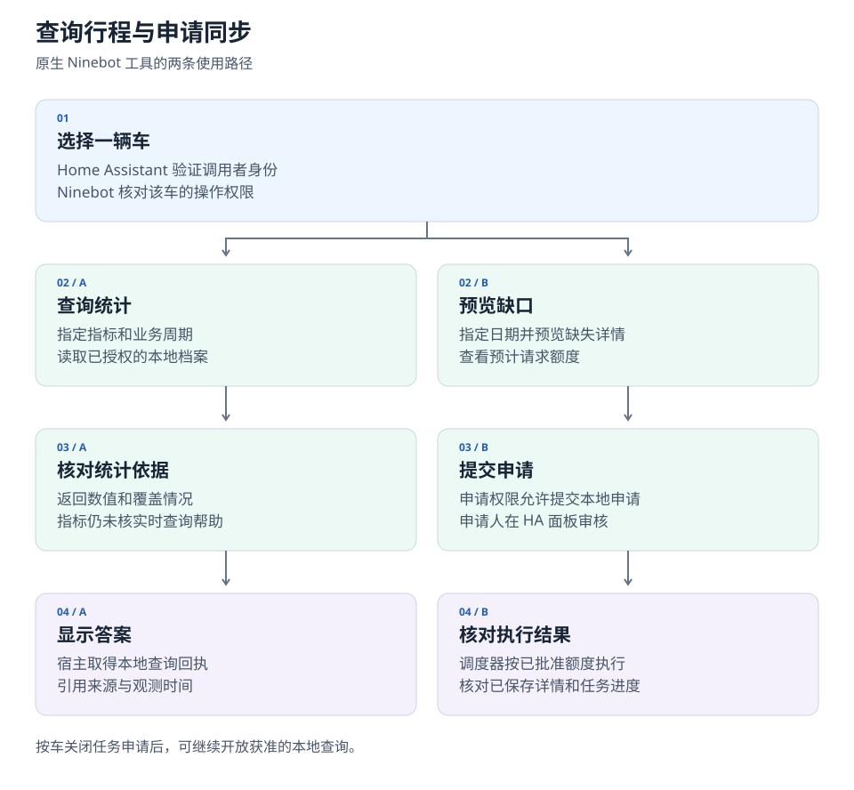

# Ninebot for Home Assistant

**在 Home Assistant 中查看车况、保留行程，并按需使用车辆助手。**

[English](README.md) · 简体中文

<!-- ha-marketplace:exclude-start -->
   
<!-- ha-marketplace:exclude-end -->

[安装](#安装) · [历史行程](#历史行程轨迹与详情同步) · [Assistant](#ninebot-assistant) · [文档导航](docs/README.md)

把九号车辆接入 Home Assistant，查看实时车况，长期保存行程，并将数据用于日常自动化。每个账号分别管理车辆、授权和本地 SQLite 档案。

**正式版** · [v2.2.0](https://github.com/Wuty-zju/ha_ninebot/releases/latest)，适合日常使用。**预览版** · [v2.2.15](CHANGELOG.md#2215) 可从[本地行程档案面板](docs/history_zh.md#local-archive-replay)回放已保存的轨迹，也可[追问另一辆车上个月的耗电量](docs/assistant_zh.md#compound-statistics)。之前在宿主中选过 **Ninebot tasks** 的用户可查看[统一入口迁移说明](docs/assistant_zh.md#升级至统一的-ninebot-api)。

## 可以做什么

| 从哪里开始 | 可以看到什么 |
|---|---|
| **设备页面** | 查看车辆上报的主电池电量、续航、温度、位置和已确认的锁状态。这些实体可直接用于仪表盘与自动化。 |
| **行程档案** | 查询日／月统计，启用行程日历，长期保存已经取得的详细轨迹。 |
| **历史地图** · 预览 | 跨车辆和日期选取最多五趟行程。在一张地图上看路线从哪里分开，重放其中一趟，并比较整趟的时间、里程与能耗。 |
| **Assistant** · 可选 | 向支持工具调用的宿主询问一辆车。回答可以引用观测时间、已存行程、周期统计或使用指南。 |

## 安装

### 环境要求

需要 Home Assistant **2026.1.0 或更新版本**、受支持的 64 位运行环境，以及在九号 App 中可以查看车辆的账号。登录和实时数据需要联网，已保存的行程可以在本地读取。可选 Assistant 工具还需要兼容的 HA 原生 API 和对话宿主。[运行环境与账号](docs/guide_zh.md#环境要求)

支持平台和账号服务地区的验证情况见使用指南。

<!-- ha-marketplace:exclude-start -->

### Marketplace · Home Assistant 2026.11 及更新版本

目前通过链接安装。打开 **设置 → Marketplace → ⋮ → 通过链接添加**，按提示连接 GitHub，输入 `Wuty-zju/ha_ninebot`，类别选 **集成**。安装正式版后，进入 Ninebot 的账号设置。同意 Marketplace 提示后，默认目录中的项目可直接搜索并安装。 [Marketplace 安装指南](docs/guide_zh.md#通过-marketplace-安装ha-202611)

### 旧版本 Home Assistant 上的 HACS

1. 打开 **HACS → ⋮ → 自定义仓库**，添加 `https://github.com/Wuty-zju/ha_ninebot`，类型选 **集成**。
2. 选择 **Ninebot**，安装正式版并按提示重启。
3. 前往 **设置 → 设备与服务 → 添加集成 → Ninebot**。

### 手动安装

从[最新正式版](https://github.com/Wuty-zju/ha_ninebot/releases/latest)下载 `ninebot.zip`，解压至 `<config>/custom_components/ninebot/`，使该目录直接包含 `manifest.json`。重启后在「设备与服务」添加 Ninebot。发行版同时提供 `SHA256SUMS`。

<!-- ha-marketplace:exclude-end -->

### 从 1.x 升级

先备份 Home Assistant 配置及私有存储。2.0 重构了账号模型，并将部分控制迁移到原生锁实体。升级后可对照指南核对原有自动化。已在使用 2.x 的安装可就地更新。[迁移与回退](docs/migration_zh.md)

## 添加账号

进入 **设置 → 设备与服务 → 添加集成 → Ninebot** 登录。每个账号独立配置。新账号使用**均衡**轮询，位置和符合条件的车辆控制可分别设置。在**配置**中选择允许接收控制指令的车辆。

如需建立轨迹库，可开启**自动扫描历史行程**和**自动同步历史详情**。行程日历与 Assistant 各有独立开关。主电池额定电压、容量可留空，知道铭牌值后再填。[默认值与选项](docs/guide_zh.md#配置选项)

## 历史行程、轨迹与详情同步

今日、昨日、本月与最近行程可直接看设备页面。要查看某次出行，打开行程卡片，选择车辆与日期范围，点选一趟，再用 **+** 加入其他行程。所有编号路线共享一张 Home Assistant 地图。路线重叠时，按车名和出发时间选择。

| 2.2.12 地图上可以看到 | 读数含义 |
|---|---|
| 轨迹回放 | 光标按保存顺序经过各点，可拖动查看。里程、时长与耗电量始终描述整趟行程。 |
| 当前行程与全部所选行程 | 可将当前行程与最多五趟所选行程比较。平均速度取总里程除以各趟时长之和，平均能耗取总耗电量除以总里程。缺少输入时显示有数据的行程数。 |
| 专看一趟 | 选择只保留当前行程可移除其余路线，保留当前回放位置。仅有起终点的记录以两个独立点展示。 |

卡片读取本地账号档案。自动化可使用 `ninebot.get_recorded_trips` 和 `ninebot.get_trip_detail` 查询同一批记录。[添加地图与理解覆盖情况](docs/history_zh.md)

## Ninebot Assistant

为车辆选择可供助手读取的数据，再在 Assist 宿主或 Home Assistant MCP Server 中选择 **Ninebot**。外部客户端可连接 `/api/mcp/ninebot`。自动化可通过 `ninebot.ask` 指定车辆和已有的 `ai_task` 实体。模型由宿主选择。

<picture>
  <source media="(prefers-color-scheme: dark)" srcset="docs/assets/architecture/assistant-zh-dark.svg">
  
</picture>

| 问题或请求 | 回答依据或后续操作 |
|---|---|
| “昨天骑了几趟？” | 返回所选车辆的业务日期、次数、覆盖情况与观测时间。同名车辆可以用 HA 设备标识区分。 |
| “这个次数为什么未知？” | 2.2.12 只查指定指标。已经结束、覆盖完整且值已核实的周期读一次即止。仍有疑问时可取带出处的帮助；获得该车的同步权限后才读取同步状态。 |
| “把这几天缺少的详情存下来。” | 助手可预览本地缺口或提交有范围的申请。申请人在 Home Assistant 中审核日期和请求预算，确认后调度器才会开始。 |

精确轨迹保存在地图与档案中。使用外部模型前可逐车检查允许传出的指标、日期和名称。[配置 Assistant 与逐车授权](docs/assistant_zh.md)

查看本地查询与人工审核的任务流程

<picture>
  <source media="(prefers-color-scheme: dark)" srcset="docs/assets/architecture/assistant-tasks-zh-dark.svg">
  
</picture>

## 工作原理

每个账号分别调度实时观测与历史采集。同组实体共享最近一次成功读取。打开已存行程或拖动回放时，卡片使用本地数据。

<picture>
  <source media="(prefers-color-scheme: dark)" srcset="docs/assets/architecture/overview-zh-dark.svg">
  
</picture>

**均衡**档位下，停车时状态和电池均以 60 秒为目标。充电时分别为 15 秒和 30 秒，ACC 开启时分别为 10 秒和 30 秒。控制指令使用独立的短时回读窗口。[刷新档位](docs/guide_zh.md#配置选项) · [技术架构](docs/architecture.md)

## 本地行程数据库

每个账号用 SQLite 保存行程、归属月份、来源依据和已取得的最佳轨迹。每页数据与断点一起提交，中断后可接着同步。云端后续只返回起终点时，标量数据仍可更新，之前保存的多点轨迹可继续查看。

<picture>
  <source media="(prefers-color-scheme: dark)" srcset="docs/assets/architecture/archive-zh-dark.svg">
  
</picture>

每个账号默认 **100 MiB** 存储空间，后台采集默认共享**每小时 60 次逻辑请求**。删除账号默认保留档案。可导出一辆或多辆车用于迁移，也可重新添加同账号接续增量同步。含位置的导出文件和 HA 备份需要妥善保管。[备份与恢复](docs/guide_zh.md#导出和导入历史数据库) · [存储机制](docs/architecture.md#storage-and-integrity)

## 文档与贡献

| 用途 | 入口 |
|---|---|
| 安装与升级 | [日常使用](docs/guide_zh.md) · [迁移和实体身份](docs/migration_zh.md) |
| 仪表盘与自动化 | [行程与地图](docs/history_zh.md) · [Assistant 工具与权限](docs/assistant_zh.md) |
| 开发与审阅 | [源码与测试导航](docs/development.md) · [架构](docs/architecture.md) · [贡献流程](CONTRIBUTING.md) · [Agent 手册](AGENTS.md) |
| 跟踪进展 | [开发路线](docs/roadmap.md) · [版本记录](CHANGELOG.md) · [全部文档](docs/README.md) |

**Downloads** 统计 GitHub 各版本 `ninebot.zip` 安装包的下载次数，包含更新与重复下载。[下载量口径](docs/development.md#package-download-audit)

## 许可证与致谢

本项目独立维护，采用 MIT 许可证。九号、Segway 名称与相关图像归其权利人所有。[许可证](LICENSE) · [依赖与致谢](NOTICE) · [安全反馈](SECURITY.md)
