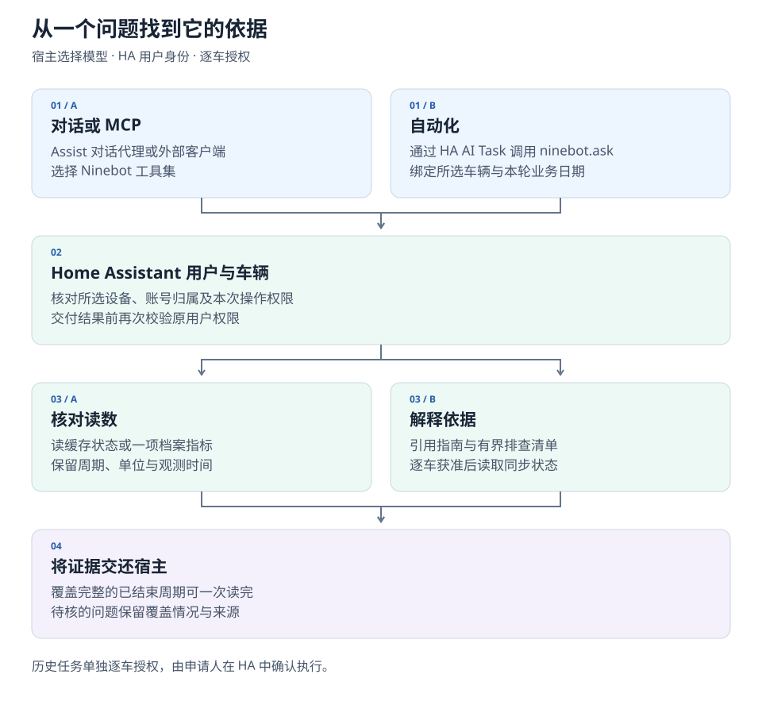
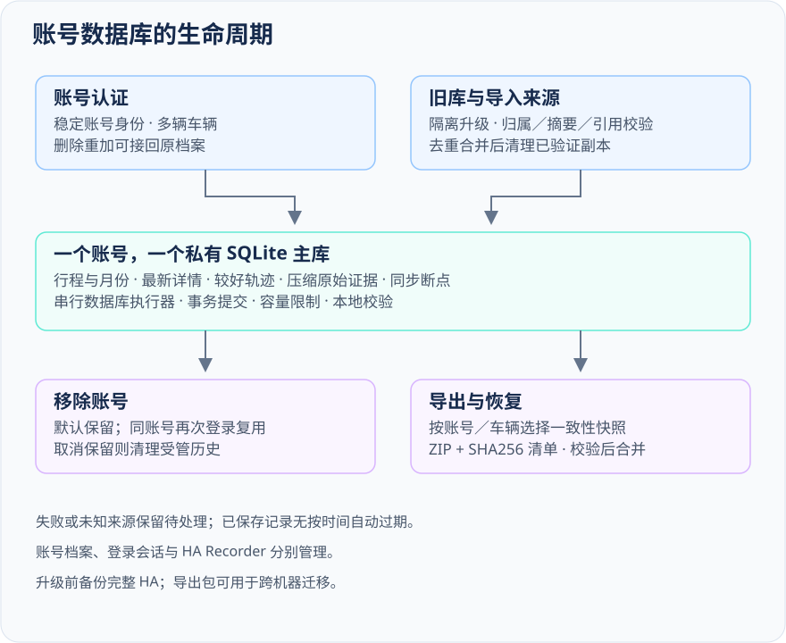

# Ninebot for Home Assistant

**在 Home Assistant 查看车辆状态，保存历史行程并配置自动化。**

[English](README.md) · 简体中文

<!-- ha-marketplace:exclude-start -->
   
<!-- ha-marketplace:exclude-end -->

[安装](#安装) · [历史行程](#历史行程轨迹与详情同步) · [Assistant](#ninebot-assistant) · [文档导航](docs/README.md)

将九号车辆接入 Home Assistant，查看电量和续航、操作车辆、统计行程，并在本地长期保存路线。每个账号有独立的车辆、更新调度和 SQLite 档案。仪表盘、自动化和可选 Assistant 都能使用这些记录。

日常使用请选择[最新正式版](https://github.com/Wuty-zju/ha_ninebot/releases/latest)。[2.2.10 预览版](CHANGELOG.md#2210)支持区分同名车辆，助手跨午夜查询时会沿用提问当天的业务日期。使用 **Ninebot tasks** 的宿主请先查看[升级步骤](docs/assistant_zh.md#升级至统一的-ninebot-api)。[全部版本](https://github.com/Wuty-zju/ha_ninebot/releases)

## 可以做什么

| 入口 | 可以做什么 |
|---|---|
| 车辆设备页面 | 查看主电池和应急通信电池电量、各类续航、BMS 读数及最近确认的锁状态。可用字段取决于车型。 |
| 地图和自动化 | 查看最近上报的位置，用车辆或行程事件触发自动化，操作受支持的车辆控制并查看回读状态。 |
| 行程档案 | 查找昨天骑过的路线，比较每月能耗，恢复已保存的行程。再次添加同一账号时可接回原档案。 |
| 历史行程卡片 · 早期 Alpha | 按日期和车辆筛选，在同一张地图比较最多五条路线，按顺序回放已保存的采样点。 |
| Ninebot Assistant · 按需启用 | 询问一辆车骑了多远、为什么历史记录不完整，并查看观测时间、覆盖情况、原始依据或公开指南。 |

## 安装

### 环境要求

需要 Home Assistant **2026.1.0 或更新版本**、受支持的 64 位运行环境，以及在九号 App 中可以查看车辆的账号。登录和实时数据需要联网，已保存的行程可以在本地读取。可选 Assistant 工具还需要兼容的 HA 原生 API 和对话宿主。[运行环境与账号](docs/guide_zh.md#环境要求)

支持平台和账号服务地区的验证情况见使用指南。

<!-- ha-marketplace:exclude-start -->

### Marketplace · Home Assistant 2026.11 及更新版本

目前通过链接安装。打开 **设置 → Marketplace → ⋮ → 通过链接添加**，按提示连接 GitHub，输入 `Wuty-zju/ha_ninebot`，类别选 **集成**。安装正式版后，进入 Ninebot 的账号设置。同意 Marketplace 提示后，默认目录中的项目可直接搜索并安装。 [Marketplace 安装指南](docs/guide_zh.md#通过-marketplace-安装ha-202611)

### 旧版本 Home Assistant 上的 HACS

1. 打开 **HACS → ⋮ → 自定义仓库**，添加 `https://github.com/Wuty-zju/ha_ninebot`，类型选 **集成**。
2. 选择 **Ninebot**，安装正式版并按提示重启。
3. 前往 **设置 → 设备与服务 → 添加集成 → Ninebot**。

### 手动安装

从[最新正式版](https://github.com/Wuty-zju/ha_ninebot/releases/latest)下载 `ninebot.zip`，解压至 `<config>/custom_components/ninebot/`，使该目录直接包含 `manifest.json`。重启后在「设备与服务」添加 Ninebot。发行版同时提供 `SHA256SUMS`。

<!-- ha-marketplace:exclude-end -->

### 从 1.x 升级

先备份 Home Assistant 配置及私有存储。2.0 重构了账号模型，并将部分控制迁移到原生锁实体。升级后可对照指南核对原有自动化。已在使用 2.x 的安装可就地更新。[迁移与回退](docs/migration_zh.md)

## 添加账号

打开 **设置 → 设备与服务 → 添加集成 → Ninebot**，登录后进入该账号的**配置**。首次设置使用均衡刷新，启用车辆位置与支持的车辆控制。车辆还需要在允许控制的列表中。

需要日历或后台扫描、保存详情时，分别在账号设置中开启。知道主电池额定参数时再填写。移除账号默认保留本地档案。[全部默认值与选项](docs/guide_zh.md#配置选项)

## 历史行程、轨迹与详情同步

单次行程的摘要与最高质量轨迹分别保存。云端修正里程后可以更新摘要，同时保留此前保存的完整路线。月份分页经过校验，后台任务共享账号预算并保存断点。中断后可续扫，浏览已保存的行程则直接读取本地档案。

| 想看什么 | 使用入口 |
|---|---|
| 今日、昨日、本月和最近一程 | 使用原生传感器。可选日历按日期展示，导入聚合数据后可用原生统计卡片画趋势图。 |
| 一辆或多辆车的跨月记录 | 在仪表盘行程列表按车辆、日期筛选，用 **+** 加入比较，点击地图或列表选择当前行程。 |
| 重放和比较路线 | 点击**播放**或拖动采样滑块。2.2.8 可点击地图编号切换路线，展开**所选行程合计**查看距离、时长和能耗。 |
| 自动化所需的明细 | 用 `ninebot.get_recorded_trips` 列出本地记录，再用设备及行程标识调用 `ninebot.get_trip_detail`。 |

已采样路线按保存的点序播放。有些旧行程只返回起终点，地图会分别标记两点。[添加卡片、查询历史和理解覆盖率](docs/history_zh.md)

## Ninebot Assistant

为账号开启 **Ninebot Assistant** 后，按车辆选择可读取的数据。在兼容的 Assist 对话代理或原生 MCP Server 中选择 **Ninebot**，MCP 客户端也可以直连 `/api/mcp/ninebot`。自动化可通过已有的 HA AI Task 调用 `ninebot.ask` 查询指定车辆。模型由宿主选择。

<picture>
  <source media="(prefers-color-scheme: dark)" srcset="docs/assets/architecture/assistant-zh-dark.svg">
  
</picture>

| 可以这样问 | 答案的依据 |
|---|---|
| “这辆车的主电池电量是多少？” | 所选读数、单位和该组数据的观测时间。 |
| “昨天骑了几趟？” | 该车按业务日期保存的本地统计和覆盖情况。 |
| “为什么本月统计未知？” | 依次核对统计值、档案进度和适用指南。证据不足时会保留未知原因。 |
| “地图回放按什么顺序播放？” | 当前版本的中英文公开指南与固定来源链接。 |

八项查询工具使用已有车况、本地档案和版本帮助。车辆获准后，同一集合还可预览历史缺口或申请限定范围的补同步。原申请人在 HA 面板核对范围和请求额度后批准。Assistant 的回复不含精确坐标和账号凭据。[配置访问与审核任务](docs/assistant_zh.md)

## 工作原理

<picture>
  <source media="(prefers-color-scheme: dark)" srcset="docs/assets/architecture/overview-zh-dark.svg">
  
</picture>

同一辆车的状态、BMS、本月行程和车辆发现各有自己的查询周期。均衡档下，停车时状态和电池均以 60 秒为目标；充电时分别为 15 秒和 30 秒。ACC 活跃时分别为 10 秒和 30 秒。控制指令发出后有短时加速回读，多实体共享结果。[刷新档位](docs/guide_zh.md#刷新速度) · [控制回读](docs/architecture.md#realtime-scheduling-and-controls)

## 本地行程数据库

<picture>
  <source media="(prefers-color-scheme: dark)" srcset="docs/assets/architecture/archive-zh-dark.svg">
  
</picture>

每个账号的 SQLite 档案保存行程、月份归属、压缩后的来源记录和经核验的最佳轨迹。分页与断点在同一事务内提交。默认每账号每小时 60 次逻辑历史请求，存储限额 100 MiB。在本地浏览记录不会消耗云端请求额度。

可以导出选定车辆或账号，也可在重装后接回同一账号档案。导入会校验归属并合并重叠记录。档案导出和 HA 备份可能包含精确位置。[导出和恢复](docs/guide_zh.md#导出和导入历史数据库) · [存储契约](docs/architecture.md#storage-and-integrity)

## 文档与贡献

[使用指南](docs/guide_zh.md) · [历史与地图](docs/history_zh.md) · [Assistant 工具与权限](docs/assistant_zh.md) · [升级和实体 ID](docs/migration_zh.md)

开发时可从源码索引和对应的小范围验证开始。路线图分别记录已交付能力与后续计划。[架构](docs/architecture.md) · [开发与验证](docs/development.md) · [贡献指南](CONTRIBUTING.md) · [Agent 导航](AGENTS.md) · [路线图](docs/roadmap.md)

Downloads 徽章统计各版本 `ninebot.zip` 附件的下载次数，包含重复下载和更新。[统计口径](docs/development.md#package-download-audit)

## 许可证与致谢

本项目独立维护，采用 MIT 许可证。九号、Segway 名称与相关图像归其权利人所有。[许可证](LICENSE) · [依赖与致谢](NOTICE) · [安全反馈](SECURITY.md)
