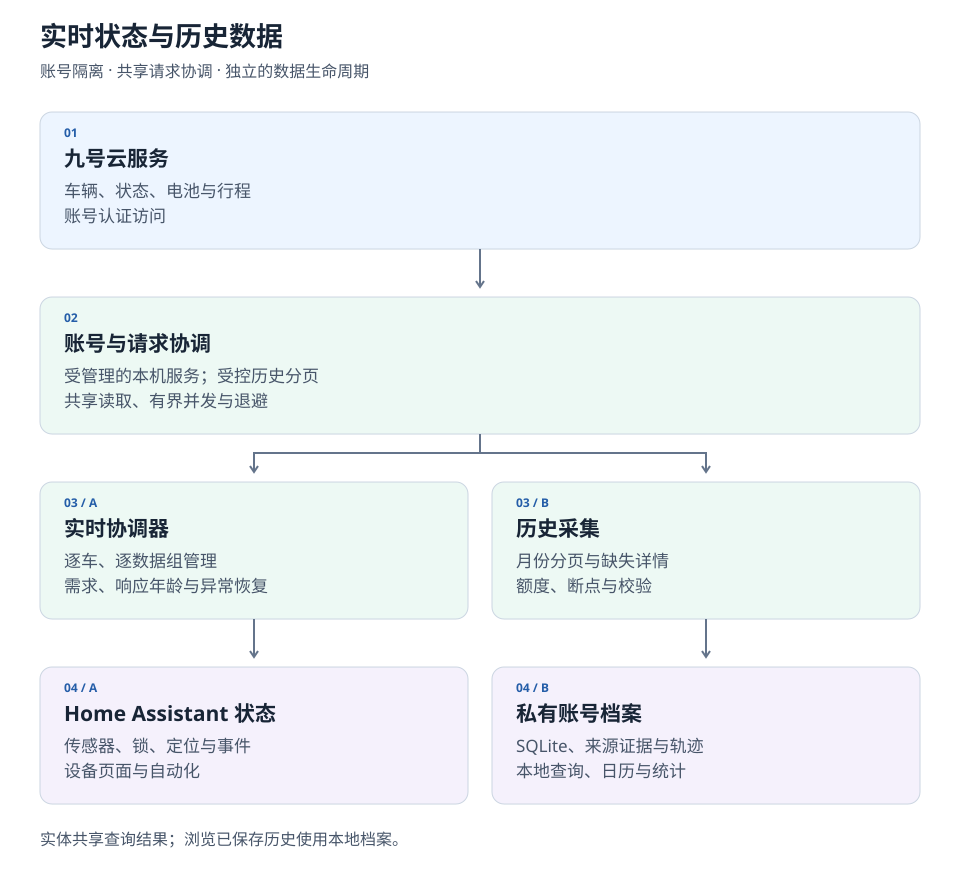
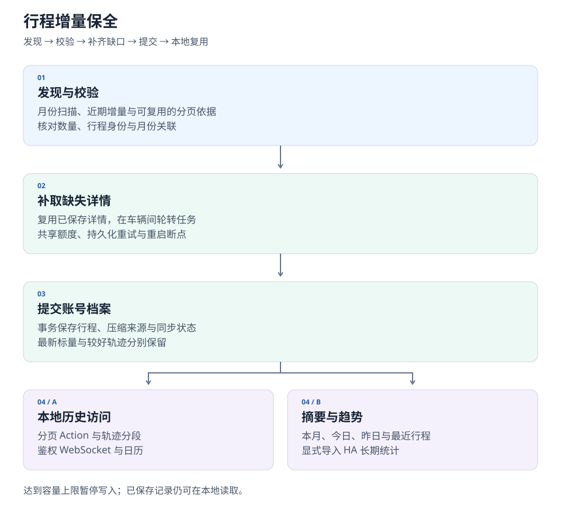
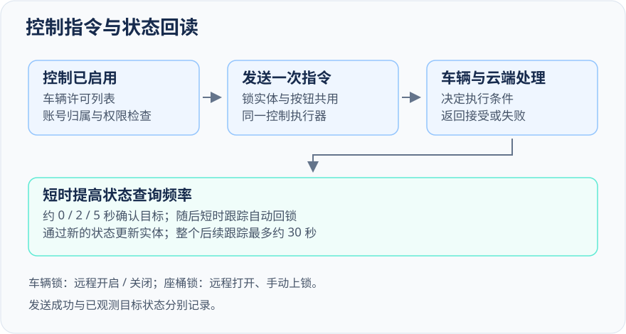

# Ninebot for Home Assistant

**在 Home Assistant 查看车辆状态，保存历史行程，并查询自己的骑行记录。**

[English](README.md) · 简体中文

<!-- ha-marketplace:exclude-start -->
   
<!-- ha-marketplace:exclude-end -->

[安装](#安装) · [历史行程](#历史行程轨迹与详情同步) · [Ninebot Assistant](#ninebot-assistant) · [工作原理](#工作原理) · [文档导航](docs/README.md)

添加九号账号后，可以在车辆设备页查看电量、续航、位置和锁状态。历史行程可保存到本地，通过日历、统计图或自动化查询。启用 Ninebot Assistant 后，也可以用自己选择的 AI 宿主查询同一份记录。

**[正式版 · v2.2.0](https://github.com/Wuty-zju/ha_ninebot/releases/tag/v2.2.0)** 整合了 2.0 维护版与 2.1 系列的改进。已使用 2.x 的账号可直接升级，继续使用原有设置、实体和行程档案。[版本变更](CHANGELOG.md#220) · [升级指南](docs/migration_zh.md)

## 可以做什么

| 使用场景 | 信息与操作 |
|---|---|
| **车辆设备页** | 查看主电池和应急通信电池电量、实测电压、温度、循环和充电功率。精准续航、预估续航和 AI 预估续航分别读取各自的上报字段。|
| **地图与控制** | 定位车辆，使用车型支持的开锁、上锁、打开座桶或鸣笛操作。发送指令后，集成会加快查询以确认状态。|
| **行程概览** | 统计今天、昨天和本月的行程，查看最近一次骑行。最高速度取自上报值，平均速度按距离和耗时计算。|
| **本地历史** | 按日期浏览已保存的行程、日历和轨迹。将日或月汇总导入 Home Assistant 长期统计，供原生图表使用。|
| **自动化与对话** | 订阅车辆或行程事件，查询结构化动作响应，或向兼容的 Assistant 宿主询问授权车辆的信息。|

不同车型上报的字段不同。一个有依据的零值和一项缺失读数会分别呈现。[实体、单位与可用性](docs/guide_zh.md#实体与数据)

## 安装

### 环境要求

需要 Home Assistant **2026.1.0 或更新版本**、受支持的 64 位运行环境，以及在九号 App 中可以查看车辆的账号。登录和实时数据需要联网，已保存的行程可以在本地读取。可选 Assistant 工具还需要兼容的 HA 原生 API 和对话宿主。[运行环境与账号](docs/guide_zh.md#环境要求)

当前已用中国大陆版「九号出行」账号验证。其他服务地区的登录和车辆数据可用性有待验证。

<!-- ha-marketplace:exclude-start -->

### Marketplace · Home Assistant 2026.11 及更新版本

目前通过链接安装。打开 **设置 → Marketplace → ⋮ → 通过链接添加**，按提示连接 GitHub，输入 `Wuty-zju/ha_ninebot`，类别选 **集成**。安装正式版后，进入 Ninebot 的账号设置。同意 Marketplace 提示后，默认目录中的项目可直接搜索并安装。 [Marketplace 安装指南](docs/guide_zh.md#通过-marketplace-安装ha-202611)

### 旧版本 Home Assistant 上的 HACS

1. 打开 **HACS → ⋮ → 自定义仓库**，添加 `https://github.com/Wuty-zju/ha_ninebot`，类型选 **集成**。
2. 选择 **Ninebot**，安装正式版并按提示重启。
3. 前往 **设置 → 设备与服务 → 添加集成 → Ninebot**。

### 手动安装

从[最新正式版](https://github.com/Wuty-zju/ha_ninebot/releases/latest)下载 `ninebot.zip`，解压至 `<config>/custom_components/ninebot/`，使该目录直接包含 `manifest.json`。重启后在「设备与服务」添加 Ninebot。发行版同时提供 `SHA256SUMS`。

<!-- ha-marketplace:exclude-end -->

### 从 1.x 升级

先备份 Home Assistant 配置及私有存储。2.0 重构了账号模型，并将部分控制迁移到原生锁实体。升级后可对照指南核对原有自动化。已在使用 2.x 的安装可就地更新。[迁移与回退](docs/migration_zh.md)

## 添加账号

使用九号 App 的账号和密码登录。每个账号都有独立的集成条目、会话和本地档案。登录后通过 **配置** 选择本账号启用的功能。

### 选择运行功能

| 新账号选项 | 默认设置 |
|---|---|
| 更新速度 | **均衡**，按车辆及数据组分别调度 |
| 显示位置、车辆控制、车辆与行程事件（Beta） | **开启**。控制默认选中登录时已核实的车辆 |
| 删除账号时保留本地行程数据库（Beta） | **开启** |
| 行程日历、自动扫描历史行程、自动同步历史详情（Beta） | **关闭** |
| Ninebot Assistant 与 Assistant 历史任务（Beta） | **关闭**，需要单独授权账号和车辆 |
| 显示调试实体 | **关闭** |

已有选择会随升级保留。主电池额定参数可以留空。[更新档位、选项与限额](docs/guide_zh.md#配置选项)

## Ninebot Assistant

在账号选项中启用 Assistant 并选择车辆，然后在兼容的原生对话宿主或 MCP 客户端中选用 **Ninebot** 工具集。可以问“昨天骑了多远？”或“为什么行程详情在等待额度？”。八项只读工具使用本地状态、档案统计和带版本的帮助资料，模型由所选宿主提供。

自动化可以通过 `ninebot.ask` 调用已有的 HA AI 任务。`answer.text` 可直接展示有来源的帮助摘录，或带覆盖情况的实测结果。`results` 提供对应的工具响应。外部宿主自行生成的回答可能采用不同措辞。

独立的 **Ninebot tasks** 选项可用于申请补齐缺失行程详情。管理员可以先核对车辆、日期和请求额度，再交给历史同步调度器执行。[Assistant 设置、示例与隐私](docs/assistant_zh.md)

## 历史行程、轨迹与详情同步

### 保存哪些信息

本地档案保存行程身份、起止时间、距离、时长、能耗及车型上报的速度。详情中还可能含 GPS 点及采样曲线。汇总和最佳轨迹分别保存，同一行程可同时保留修正后的里程和较早取得的完整轨迹。

### 同步如何推进

在账号配置中开启 **自动扫描历史行程** 与 **自动同步历史详情** 后，后台会核对月页和行程身份，再增量获取缺失或到期的详情。每个已提交页面都有同步进度。月份和详情请求共享账号额度，日历、浏览和本地校验读取已有记录。

每账号默认每小时 **60 次逻辑请求**，默认存储额度为 **100 MiB**。达到存储额度后暂停写入，已有记录仍可查询。设备诊断可查看已发现月份、已保存详情和缺口。[同步、覆盖率与恢复](docs/history_zh.md)

### 使用已存信息

| 想做什么 | 入口 |
|---|---|
| 列出行程或读取已保存轨迹 | `ninebot.get_recorded_trips`、本地模式的 `ninebot.get_trip_detail` |
| 计算一个时段的总量 | `ninebot.get_statistics` |
| 绘制每日或每月统计 | `ninebot.import_statistics` 和原生统计图卡片 |
| 按日期浏览或响应新行程 | 车辆的行程日历、车辆行程事件 |
| 继续后台采集 | 历史同步控制或 `ninebot.sync_history` |

列表分页查询，轨迹点分块读取。随包提供的地图与自定义卡片仍处于 **早期 Alpha**。[历史查询示例与地图配置](docs/history_zh.md)

## 2.2 正式版更新

| 方向 | 自上一正式周期以来的进展 |
|---|---|
| **安装与支持** | 打包交付、Marketplace 元数据与品牌图、登录排查和可分享的脱敏诊断。|
| **本地档案** | 细分覆盖依据，减少中断后重复请求；同一行程由两个月份收录时，导入仍保留最佳轨迹。|
| **车辆控制反馈** | 按受支持车型选择控制路径，分别记录指令响应和状态回读，保留确认窗口结束前已完成的观测。|
| **可选 Assistant** | 按车辆授权的原生工具、双语版本化帮助、受限统计排查、人工审核的同步申请，以及有证据的动作响应。|

[逐版变更](CHANGELOG.md) · [2.0 重构历程](docs/releases/2.0.md)

## 本地行程数据库

每个账号使用一份独立的 SQLite 档案，当前数据库格式为第 7 版。月份、行程、月份归属和压缩的来源记录保存在同一档案内。保存月页时通过事务同时写入进度。导入前会核对账号归属和行程身份，重叠备份中的最新测量值与最佳轨迹可以独立保留。

<picture>
  <source media="(prefers-color-scheme: dark)" srcset="docs/assets/architecture/archive-zh-dark.svg">
  
</picture>

删除账号时默认保留本地历史，重新登录同一账号会接回其档案。管理员可以按车辆或账号导出、导入已校验的档案，或使用 HA 备份。导出文件可能含精确路线。[数据库导出、导入与保留](docs/guide_zh.md#导出和导入历史数据库)

## 工作原理

### 实时状态与历史采用独立生命周期

<picture>
  <source media="(prefers-color-scheme: dark)" srcset="docs/assets/architecture/overview-zh-dark.svg">
  
</picture>

同一车辆的多个实体共享一次查询。均衡档停车时，状态和 BMS 的目标间隔均为 60 秒；充电时分别为 15 秒和 30 秒；ACC 活跃时为 10 秒和 30 秒。当月行程摘要停车时通常每 600 秒更新，活跃时每 120 秒更新。车辆发现另有恢复机制。[更新档位](docs/guide_zh.md#刷新速度)

### 历史按需采集，随后本地复用

<picture>
  <source media="(prefers-color-scheme: dark)" srcset="docs/assets/architecture/history-zh-dark.svg">
  
</picture>

采集时记录来源月份、观测时间与完整性。SQLite 由账号专属的后台工作线程操作，日历、历史动作和 Assistant 使用相同的本地数据和覆盖规则。安装重启后从已落盘的进度继续。

### 控制通过新状态确认

<picture>
  <source media="(prefers-color-scheme: dark)" srcset="docs/assets/architecture/controls-zh-dark.svg">
  
</picture>

每次操作发送一次指令，随后最多用 15 秒核对状态。观测到座桶解锁后，界面至少保持解锁状态 5 秒。这个读数描述锁舌机构。设备上报状态和云端接受指令可以发生在不同时间。[控制与状态确认](docs/guide_zh.md#控制与反馈)

## 隐私与数据含义

- 历史轨迹和 HA 备份可能含精确位置。可以分别选择是否展示位置、是否加载外部底图。
- Assistant 专属读取工具省略账号凭据、原始响应和精确 GPS。提交给宿主的选定信息受该宿主的数据政策约束。
- 电池健康评分、额定容量和实测电压各有独立含义。坐标系和部分轨迹采样单位仍有待验证。
<!-- ha-marketplace:exclude-start -->
- README 的包下载徽章累加公开发行版中 `ninebot.zip` 附件的下载，含更新和重复下载。Marketplace 显示所选版本包的计数，数据会随目录刷新。旧 HACS 2.0.5 读取所选版本的首个附件。 [下载量口径](docs/development.md#package-download-audit)
<!-- ha-marketplace:exclude-end -->

## 后续方向

当前维护重点是历史采集可靠性、档案恢复以及 Assistant 回答的来源。地图与卡片交互仍在实验中。[路线图](docs/roadmap.md)

## 文档与贡献

| 读者 | 入口 |
|---|---|
| 安装和配置 | [使用指南](docs/guide_zh.md) · [升级迁移](docs/migration_zh.md) |
| 查询行程或编写自动化 | [历史行程](docs/history_zh.md) · [Ninebot Assistant](docs/assistant_zh.md) |
| 开发与审阅 | [架构](docs/architecture.md) · [开发与验证](docs/development.md) · [贡献说明](CONTRIBUTING.md) · [Agent 导航](AGENTS.md) |

可复现的问题请附集成版本、Home Assistant 版本，以及与故障有关的脱敏诊断片段。[问题反馈](https://github.com/Wuty-zju/ha_ninebot/issues) · [安全反馈](SECURITY.md)

## 许可证与致谢

集成采用 [MIT 许可证](LICENSE)。Ninebot、Segway 名称和车型图片归相应权利人所有。本项目由社区独立维护。[依赖与致谢](NOTICE)

旧 README 入口

- [安装与账号](docs/guide_zh.md)
- [当前数据与选项](docs/guide_zh.md)
- [行程、事件与控制](docs/history_zh.md)
- [升级与开发](docs/migration_zh.md)
- [缺失本地详情原件](docs/history_zh.md)
- [近期行程收尾](docs/history_zh.md)
- [历史同步进度与本地限速](docs/history_zh.md)
- [复用已核验历史月份](docs/history_zh.md)
- [当前月份来源校验](docs/history_zh.md)
- [支持与贡献](#文档与贡献)
- [隐私与限制](#隐私与数据含义)

