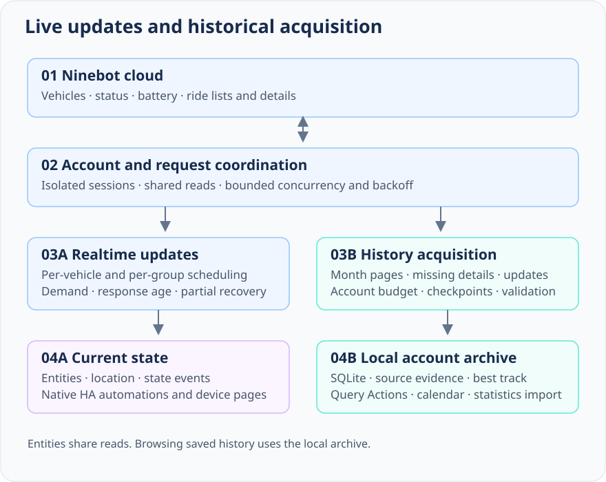
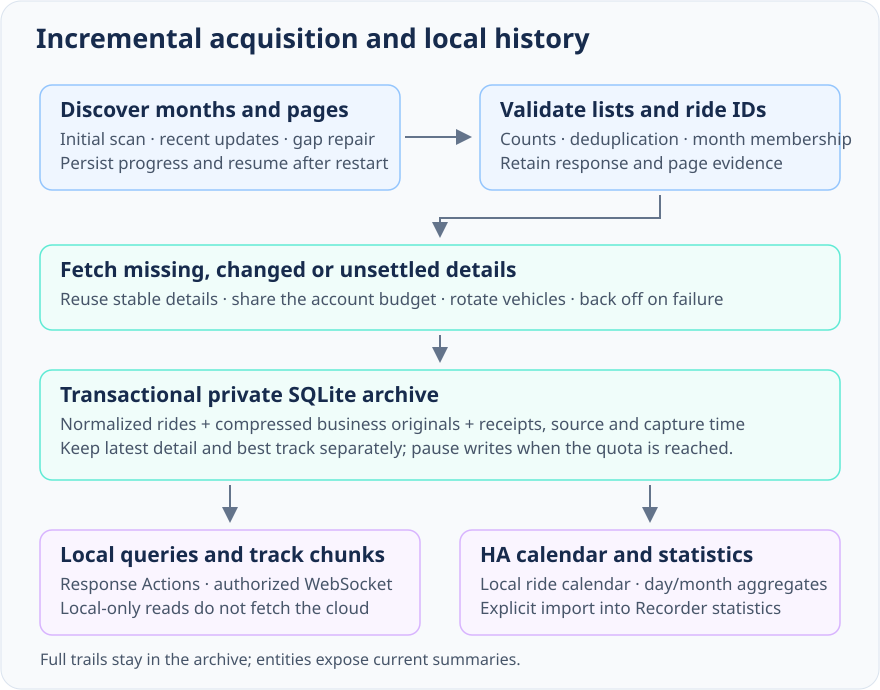

# Architecture and data contracts

[Documentation](README.md) · [Development](development.md) · [History behavior](history.md)

This is a Home Assistant integration with a cloud adapter and a private historical archive. Current-state entities, large historical queries and control acknowledgements have separate responsibilities. The runtime is entirely inside `custom_components/ninebot`; docs/tests/scripts are not runtime dependencies.

Arrows describe data relationships, not upstream push. The frontend's local archive notification is not a Ninebot cloud subscription. See [user options](guide.md#options) for current periods and budgets.

## Accounts and lifecycle

`config_flow.py` and `session.py` isolate candidate sessions, validate identity and only then commit the account. Public setup uses a password; the SMS implementation remains dormant pending delivery verification. Current HA chains into account options after creation; older HA selects features after authentication and before the candidate is committed. Reauth/reconfigure keep the established business identity. Each ConfigEntry owns a coordinator, private token/config directory, archive actor and unload lifecycle. Different accounts do not share credentials or historical ownership.

`runtime.py` manages a local loopback child with a random Bearer token. Passwords go in the local HTTP request body, not process arguments or ConfigEntry. Arbitrary upstream host overrides are not exposed. Tokens/config files remain local secrets; same-user and privileged host processes are inside the trust boundary. Unload cancels tasks/subscriptions/readback and drains/closes the account resources.

`backend.py` defines `NinebotBackend` and `BackendResult` with endpoint, source version, request/receipt timing and revision. `NinecliBackend` currently uses the precisely pinned managed serve client. Vehicle business-route initialization has a controlled native CLI exception. Explicit historical month/page reads use the reviewed native encrypted `native_history.py` adapter with existing account session/serialization; managed serve remains the token refresh writer. Do not describe every request as serve-only, or replace persistent serve with per-entity subprocess calls.

## Realtime scheduling and controls

`coordinator.py`, `demand.py` and `query_broker.py` track per-vehicle/per-group demand, freshness, partial failures and backoff. Identical in-flight reads share their result/error without renewing source receipt times. Status has bounded priority; background work and other vehicles receive turns. An account has one wire transaction; the shared gate allows two across accounts. Admission is bounded (12 reads + 4 commands, 64 readers overall, 32 on one shared read).

Transient GET transport failures can retry once within the same deadline. Authentication/schema errors and controls do not replay. Actual Retry-After metadata and existing group backoff apply. One cancelled reader does not cancel other consumers; abandoned work is reclaimed. Ownership/generation/request barriers prevent late/pre-command responses overwriting current state or confirming a command.

Controls require enablement, a vehicle allowlist and fresh ownership/status. New accounts enable controls for their sign-in-verified vehicles; existing choices and later vehicle additions are not overwritten. Known denials/ambiguity block dispatch; unknown permission remains unknown and cloud authorization decides. Vehicle/cloud enforces motion/P policy; HA does not infer it from ACC/power. Locks/buttons serialize command transmission for the same physical vehicle across accounts; newer commands can replace older confirmation observers. Accepted command, observed cloud target and physical success remain distinct. See [confirmation behavior](guide.md#controls-and-confirmation). The seat Lock presentation holds a verified unlock for five seconds; raw latch observations, confirmation and status events remain independent. Lid position is not inferred from the latch.

`daily_sync.py` repairs only incomplete current-month normalized ride indexes for enabled daily consumers when the detail-preservation worker is off. It shares the durable hourly budget and existing read broker, processes one page per update and does not fetch details or persist raw GPS. Complete indexes are reused and metric reconciliation remains separate from upstream coverage claims.

Shanghai day changes invalidate only a successful previous-day travel scheduling interval, never failure backoff or Retry-After. The midnight callback and post-platform setup use the normal coordinator request debouncer. The archive exposes an atomic memory-only current/previous-month projection and notifies daily/monthly/latest entities after writes. Entity presentation can use verified same-period cached facts with original receipts; `get_statistics` and Recorder export retain stricter closing-observation requirements. Cache continuity cannot create a new-day zero, transfer another period's totals or renew live freshness.

## Raw evidence and normalized models

`raw.py` retains bounded source records; adapters normalize reviewed fields into `models.py` and `ride_models.py`. Unknown safe business fields can remain in private evidence for future parsing. Missing/null/invalid/zero are distinct, and list/detail observations preserve provenance. Re-reading a cached record never advances its receipt age.

| Value | Established contract |
|---|---|
| precise / estimated / AI range | Separate raw fields; no cross-field fallback. |
| `ec` | Wh, maintainer-confirmed; not wall charging consumption. |
| `charging_power` | W, maintainer-confirmed. |
| health score | Score, not SOH; presentation of 0 as unsupported is a maintainer rule. |
| `battery_main.electricity` | Emergency communication battery SOC; main propulsion SOC stays separate. |
| ride maximum speed | Reviewed server maximum, separate from overall distance/duration average. |
| `used_electricity` | Raw usage with unverified unit; do not silently assign Wh or %. |
| point speed/delta/CRS/timestamps | Unverified unless that specific shape is evidenced; no automatic scaling, time inference or coordinate conversion. |

Read [fixture provenance](../tests/fixtures/ninecli/0.1.7/metadata.json) before promoting a candidate alias or unit. Recorded/synthetic/maintainer-confirmed evidence are different. Reference parsers without a clear license are behavior/schema leads, not copyable implementation.

## Historical acquisition

First discovery, new/current month work, sparse repair, detail preservation and local auditing share a resumable lifecycle rather than a poll per entity. `bootstrap.py`, `history_plan.py`, `incremental_runs.py`, `gap_recovery.py`, `preservation.py` and `history_store.py` persist checkpoints, ID/page membership, budgets and retry state. Real page bodies, receipts, totals and unique IDs are separate from normalized display projections.

Repeated/empty/schema-invalid pages, changing totals and unverified membership must not become completed history. Old months can be reused only under bounded evidence checks; current/previous months and changed evidence take the normal acquisition path. A partial response does not erase earlier known rows; a complete revised list can withdraw a ride from the current selection while retaining its original evidence. Detail tasks reuse stable payloads and protect better geometry from later simplified responses.

Current sample freshness, per-metric statistical completeness, page enumeration, root discovery, saved-detail coverage and payload/reference integrity have separate meanings. `last_success` is accepted progress; `last_completed` is task completion. Neither is a universal cloud snapshot certificate.

## Storage and integrity

`RideArchive` is a per-account SQLite actor with serialized off-loop work, parameterized bounded reads and transactional updates. It holds normalized month/ride facts, membership, compressed/redacted business originals, task state, evidence receipts and private quarantine. Full track arrays stay out of Recorder/state; only an explicit native aggregate import writes statistics.

The quota defaults to 100 MiB (options 32–2048 MiB/account); it is a write budget, not an automatic expiry policy. Capacity errors retain data and suspend writes. Unreadable/unsupported structural state is preserved with Repair. Supported reads can tolerate independently damaged detail roles without granting a write or deleting evidence. Backup hooks pause/drain writes and fence new setup writers; account removal retains history by default; explicit opt-out cleans recognized owned files, deferring when backup is active.

Schema migrations validate old structure/ownership, make an exclusive recovery copy and commit atomically. Scope/checker changes invalidate outdated certificates rather than rewriting their historical meaning. The current schema includes object receipts/quarantine; their presence is not a claim that every reference or normalized metric is correct.

Verification uses bounded compressed/decoded-byte admission, per-object work and cooperative yields. Matching identity/hash/source/checker receipts avoid unnecessary decoding; periodic deep work still checks stable objects. External file edits or future corruption cannot be detected without reading. Oversized payloads are metadata-visible but not blindly decoded; missing bytes are not reported as a copied quarantine snapshot.

Local reconstruction has durable jobs/recovery points, captured search bounds and exact source/digest checks. It can fix supported scalar/quality/reference defects or restore exact bytes from managed copies, preserving newer trustworthy scalars and independent geometry roles. It cannot infer missing data, bypass identity conflicts, certify all cloud history or treat a recovery copy as automatically valid. Pending/partially repaired/with-gaps/blocked results and unresolved Repairs remain explicit. The [history guide](history.md#verification-and-recovery) lists operations and rollback cautions.

## Local query and frontend contracts

`recorded_actions.py`/`archive_browse.py` expose bounded date pages. Older asc callers retain account revision behavior; desc pages use transactional connection-local vehicle catalog versions and single-use successful continuations. `geometry_version` binds selected evidence and parser/shape/integrity roles. These are fences against managed writes, not persistent MVCC across requests or protection from arbitrary external database edits.

`history_websocket.py` provides authenticated metadata-only subscriptions for 1–5 device IDs, at most eight per connection and 64 active/pending total. It checks read permission/ownership before delivery and debounces commit bursts. No raw/GPS is pushed. Browser network/session modules share identical local-detail in-flight promises and cancel timers/listeners on unload, reconnection or revocation; cloud operations and consumed page tokens are not shared/replayed.

The bundled workbench uses reviewed local-only detail chunks, sequence-based focus/brush/playback and bounded comparison caches. Leaflet's Canvas redraw scheduling is adapted locally in `route-renderer.js`; upgrading the pinned vendor requires checking its private-method dependency. Basemap tiles are optional external requests, not a bundled/offline map database.

## Diagnostics and Repairs

Diagnostics export allowlisted version/platform, schema shape/availability, fixed error kinds, freshness and progress metadata. No password/token/account/serial/precise location/trail or arbitrary unknown key/value is exported. Debug projections are bounded runtime views, not permission to publish raw evidence.

Repairs cover actionable identity/migration/storage/schema conditions. A temporary network timeout is a retry/backoff concern, not a reason to generate repetitive Repair issues. Successful reading of one healthy role does not erase an unresolved corruption report. Preserve evidence instead of silently deleting/reinitializing it.

## Dependencies and attribution

- Runtime protocol client: **`ninecli==0.1.7`**, fixed in [manifest.json](../custom_components/ninebot/manifest.json). HA installs the declared dependency; users do not manually install an unrelated daemon. Never change this to an unreviewed `>=`/latest range.
- Its [PyPI metadata](https://pypi.org/project/ninecli/0.1.7/) declares MIT. The audited wheel did not include standalone license text or complete Go source; source availability, reproducible builds and transitive Go licensing remain audit limitations. The integration's MIT license does not relicense the dependency/vendor APIs.
- Reviewed native history crypto/API behavior derives from MIT [kxn/ninebot-recon](https://github.com/kxn/ninebot-recon). Runtime attribution/source pins are packaged in [licenses/SOURCES.json](../custom_components/ninebot/licenses/SOURCES.json) and [MIT notice](../custom_components/ninebot/licenses/ninebot-recon-MIT.txt). Test conformance attribution is in [tests/ninebot_recon_license.txt](../tests/ninebot_recon_license.txt).
- Leaflet 1.9.4 is bundled under its [BSD-2-Clause license](../custom_components/ninebot/frontend/vendor/leaflet/LICENSE). OpenStreetMap tiles/attribution apply when explicitly enabled.
- Ninebot/Segway trademarks and vehicle images belong to their owners. This independent project is not affiliated with or supported by them. See [NOTICE](../NOTICE) and [LICENSE](../LICENSE).

The backend abstraction permits future protocol replacement, but no production NativeBackend migration is promised by this documentation change. Source evidence and public contracts matter more than copying another application's heuristics.

简体中文摘要：实时状态、历史采集、私有归档和 HA 展示分层；账号、权限、预算与生命周期隔离。原件、派生值、覆盖和完整性各自有证据范围；不猜单位/坐标，不为演示改业务。依赖精确固定并保留许可/源码可用性限制，地图底图为用户显式外部请求。

## Connection recovery and retained availability

An empty or smaller vehicle list is uncertain discovery, not conclusive proof that a known vehicle was unbound. Keep the last verified native routing entries and account-local archive; missing vehicles retain their original profile receipt and controls remain blocked until positively verified again. Previously verified read-only status polling is bounded by the existing profile validity window. Repeated omissions do not renew that window or prove revocation. Authentication invalidation and explicit lifecycle/ownership fences remain authoritative.

Discovery errors use short, bounded backoff instead of the normal one-hour discovery interval. A single demand-driven timer refreshes due status and degraded discovery independently of the normal battery/travel round. It shares existing in-flight work, the account transaction lock and the global broker: no second service, credential owner or unlimited parallel requests. Successful status commits notify entities immediately. Polls use request-start-based targets; missed periods are coalesced rather than replayed.

The broker reserves admission for real-time reads, honors Retry-After and bounds connection-recovery cooldown. Background history pauses for uncertain vehicles or a shared transport cooldown; positively verified vehicles in a partial result can continue from existing checkpoints. Active native authentication/cache writes are never preempted to meet a polling deadline. Local process recovery and bounded GET retries remain in the authenticated loopback client; control POSTs are never replayed.

Diagnostics include uncertain-discovery counts, next retry, configured status interval, observed request intervals, missed deadlines and response age. Receipt time is not a verified vehicle report timestamp. A configured interval is a scheduling target, not a cloud availability guarantee: upstream outage, rate limits, fleet size and an already active slow request can delay fresh responses. Same-period verified history remains usable; expired instantaneous lock, location or battery readings do not become fresh through cache restoration.

简体中文：空／缺车发现进入待复核，保留路由和本地历史，不刷新缺失车辆的归属有效期；控制待再次核验。独立有界状态定时器共享现有Broker与认证锁，成功立即更新；历史任务在发现／连接异常时让路并按断点恢复。服务端限流与在途事务仍受保护，轮询周期是目标而非云端成功保证；诊断显示实际间隔、响应年龄与下次重试。

## Account archive lifecycle and portability

`account_archive.py` binds `.storage/ninebot/accounts/<SHA256 business UID>/rides.sqlite3` to a verified account, independently of ConfigEntry lifetime. Setup validates the authenticated UID first, then merges matching legacy entry archives on isolated copies and retires their original directories. A failed migration retains its inputs; it never initializes over an unreadable archive. Entity IDs and Recorder storage are separate from this lifecycle.

`archive_transfer.py` uses SQLite’s backup API on the existing SQL actor. Versioned ZIP manifests identify each account snapshot and its immutable historical evidence by SHA256. Vehicle exports filter every scoped table and remove unselected payloads/job metadata, then VACUUM the private snapshot. Uploads reject extra/duplicate members, traversal, symlinks, oversized content, executable SQLite objects, foreign owners, invalid references and corrupt raw payloads. Schema SQL from an upload is never executed in the destination.

Imports replay reviewed vehicle/month/ride/membership/detail facts in a single account transaction. Newer month receipts win, historical membership is retained, and latest raw detail versus best geometry are selected independently. Imported profiles do not grant live ownership. Original page evidence is kept in bounded private `imports/` snapshots and re-exported; existing account checkpoints survive, and audit receipts, connection sessions and hourly budgets are not copied. If no local discovery baseline exists, verified committed page coverage is restored with in-flight query claims reset; an existing baseline is never replaced. Import receipts make retries idempotent; transactions and a pre-merge `recovery.sqlite3` provide separate rollback boundaries. Multi-account packages commit per account, not as a distributed transaction.

Native options forms use HA file upload, administrator authorization and expiring signed downloads. No custom dashboard, public static archive directory, cloud upload or arbitrary filesystem path is needed. Full archive/transfer content remains outside entity attributes, Recorder and diagnostics. See [usage and limits](guide.md#export-and-import-history-databases).
